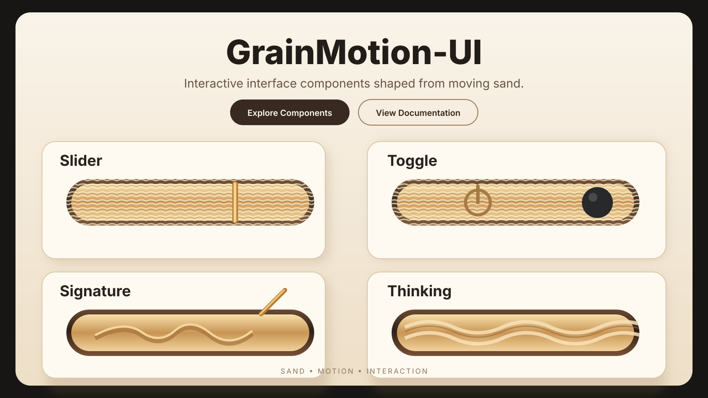
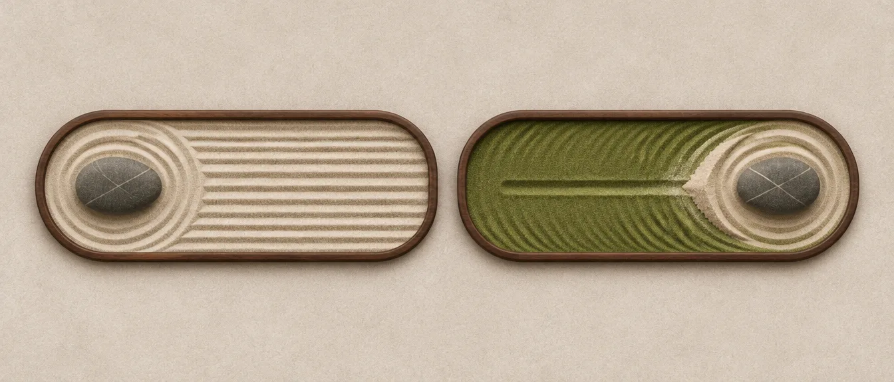
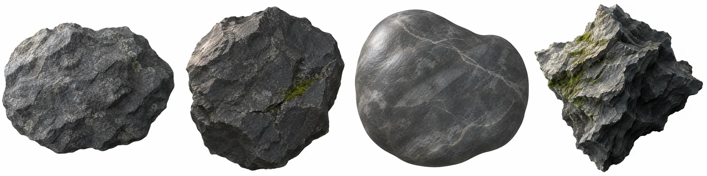

<div align="center">

# GrainMotion-UI

### Interfaces shaped by sand, motion, and interaction.

A growing collection of tactile UI controls built from a real-time sand simulation. The original four established the physical language: a bamboo rake slider, a river-stone toggle, a sand signature pad, and an AI activity surface. Phase 1 adds five selection controls, each with its own physical interaction.

[**Explore the live gallery**](https://brajesh31.github.io/GrainMotion-UI/) · [Components](#-the-components) · [Installation](#-installation) · [Documentation](#-documentation)



<p>
  <a href="https://github.com/Brajesh31/GrainMotion-UI/actions/workflows/pages.yml"></a>
  <a href="https://github.com/Brajesh31/GrainMotion-UI/actions/workflows/component-tests.yml"></a>
  
  
  
</p>

</div>

---

## ✨ What is GrainMotion-UI?

GrainMotion-UI currently includes nine standalone custom elements that simulate sand as a height field and render it with a WebGL2 shader. Instead of placing a conventional control inside a decorative skin, each interaction changes the sand itself.

- **Tactile interaction:** grooves, ridges, wakes, and settling sand respond to user input.
- **Standalone components:** each control is delivered as a single JavaScript file with its engine and sounds embedded.
- **No runtime dependencies:** no framework or package installation is required to use the controls.
- **Native-feeling behavior:** keyboard interaction, form integration where supported, and custom-element APIs.
- **Designed to be explored:** each component has a live demo and its own documentation.

## 🎛️ The components

Each component has its own live demo, usage guide, standalone JavaScript file and physical interaction concept.

| Component | Physical interaction | Demo and documentation |
|---|---|---|
| **Sand Slider** | A bamboo rake cuts grooves and pushes a ridge through the sand. | [Live demo](https://brajesh31.github.io/GrainMotion-UI/slider/) · [Documentation](slider/README.md) |
| **Sand Toggle** | A river stone glides across the tray and uncovers a pressed symbol. | [Live demo](https://brajesh31.github.io/GrainMotion-UI/toggle/) · [Documentation](toggle/README.md) |
| **Sand Signature** | A bamboo stylus writes into sand; strokes can be undone or cleared. | [Live demo](https://brajesh31.github.io/GrainMotion-UI/signature/) · [Documentation](signature/README.md) |
| **Sand Thinking** | A rock and self-raking sand represent AI activity states. | [Live demo](https://brajesh31.github.io/GrainMotion-UI/thinking/) · [Documentation](thinking/README.md) |
| **Sand Checkbox** | A pebble rolls aside to reveal a checkmark etched into its sand well. | [Live demo](https://brajesh31.github.io/GrainMotion-UI/checkbox/) · [Documentation](checkbox/README.md) |
| **Sand Radio Group** | A selected pebble moves between individual option wells. | [Live demo](https://brajesh31.github.io/GrainMotion-UI/radio-group/) · [Documentation](radio-group/README.md) |
| **Sand Segmented** | A flat stone marker glides between carved sections. | [Live demo](https://brajesh31.github.io/GrainMotion-UI/segmented/) · [Documentation](segmented/README.md) |
| **Sand Range** | Two bamboo rakes set the lower and upper bounds of an interval. | [Live demo](https://brajesh31.github.io/GrainMotion-UI/range/) · [Documentation](range/README.md) |
| **Sand Rating** | Five river stones occupy separate wells; one marks the chosen rating. | [Live demo](https://brajesh31.github.io/GrainMotion-UI/rating/) · [Documentation](rating/README.md) |

> The gallery image above shows the component set together. The concept artwork below documents visual exploration and design direction, not additional live component screenshots.

## 🖼️ Visual exploration

The project grew through a series of visual studies exploring how familiar controls could be expressed through sand, stones, grooves, and physical movement.

<div align="center">

<table>
  <tr>
    <td align="center" width="50%">
      
      <br><strong>01 · The control set</strong>
    </td>
    <td align="center" width="50%">
      
      <br><strong>02 · Stone toggle study</strong>
    </td>
  </tr>
  <tr>
    <td align="center" width="50%">
      
      <br><strong>03 · Rake slider study</strong>
    </td>
    <td align="center" width="50%">
      
      <br><strong>04 · Toggle explorations</strong>
    </td>
  </tr>
  <tr>
    <td align="center" width="50%">
      
      <br><strong>05 · Composition study</strong>
    </td>
    <td align="center" width="50%">
      
      <br><strong>06 · Stone and material study</strong>
    </td>
  </tr>
</table>

</div>

See [making-of/](making-of/) for the design notes, concept images, and prompts behind the visual direction.

## ⚙️ How it works

The sand is simulated, not a static texture. A height field stores the sand surface, JavaScript updates it as controls move, and a WebGL2 shader lights the surface to reveal grooves, ridges, shadows, and highlights.

- **Simulation:** the sand height field changes as the user interacts with a control.
- **Relaxation:** displaced sand settles toward its angle of rest.
- **Rendering:** WebGL2 shades the surface and gives the sand its depth.
- **Sound:** embedded audio recordings respond to interaction.
- **Custom elements:** each component registers a reusable HTML element.

The shared engine is available through `window.GrainMotionUI`. Each control file contains the engine and its own required assets, so it can be loaded independently.

## 🚀 Installation

### Add a component with the shadcn CLI

Run the command for the component you want:

```bash
npx shadcn add Brajesh31/GrainMotion-UI/slider
npx shadcn add Brajesh31/GrainMotion-UI/toggle
npx shadcn add Brajesh31/GrainMotion-UI/signature
npx shadcn add Brajesh31/GrainMotion-UI/thinking
npx shadcn add Brajesh31/GrainMotion-UI/checkbox
npx shadcn add Brajesh31/GrainMotion-UI/radio-group
npx shadcn add Brajesh31/GrainMotion-UI/segmented
npx shadcn add Brajesh31/GrainMotion-UI/range
npx shadcn add Brajesh31/GrainMotion-UI/rating
```

The files are intended to be placed in `public/grainmotion-ui/`.

### Use a component directly

You can also copy the relevant JavaScript file into your project and load it with a regular script tag.

```html
<script src="/grainmotion-ui/slider.js"></script>
<sand-slider value="40" label="Volume"></sand-slider>
```

Other elements:

```html
<script src="/grainmotion-ui/toggle.js"></script>
<sand-toggle label="Focus mode"></sand-toggle>

<script src="/grainmotion-ui/signature.js"></script>
<sand-signature name="signature"></sand-signature>

<script src="/grainmotion-ui/thinking.js"></script>
<sand-thinking state="thinking"></sand-thinking>

<script src="/grainmotion-ui/checkbox.js"></script>
<sand-checkbox label="Enable notifications" value="yes"></sand-checkbox>

<script src="/grainmotion-ui/radio-group.js"></script>
<sand-radio-group label="Size" options="Small,Medium,Large" value="Medium"></sand-radio-group>

<script src="/grainmotion-ui/segmented.js"></script>
<sand-segmented label="Period" options="Day,Week,Month" value="Week"></sand-segmented>

<script src="/grainmotion-ui/range.js"></script>
<sand-range label="Budget" low="20" high="80"></sand-range>

<script src="/grainmotion-ui/rating.js"></script>
<sand-rating label="Rating" value="4"></sand-rating>
```

For the thinking component, update its state as your agent works:

```js
const indicator = document.querySelector("sand-thinking");

indicator.state = "searching";
// Supported states: thinking, searching, tool, writing, idle
```

Check each component's documentation for its attributes, properties, events, and form behavior.

## 🔊 Sound controls

Sound starts after the first user touch or key interaction. You can mute the shared sound engine:

```js
window.GrainMotionUI.Sound.on = false;
```

## 🧑‍💻 Run locally

Clone the repository and start a local static server:

```bash
git clone https://github.com/Brajesh31/GrainMotion-UI.git
cd GrainMotion-UI
python3 -m http.server 8000
```

Open [http://localhost:8000](http://localhost:8000) to explore the gallery.

## 🛠️ Development

The repository includes scripts for building the standalone controls, generating documentation, capturing screenshots, and testing interactions.

| File | Purpose |
|---|---|
| `core.js` | Shared sand simulation and rendering engine |
| `tools/build.mjs` | Stamps the shared engine and embedded assets into each control |
| `tools/docs.mjs` | Generates component documentation, demo pages, registry metadata, and `llms.txt` from the component specification |
| `tools/spec.mjs` | Central component specification |
| `tools/test.mjs` | Exercises controls with touch and keyboard interactions |
| `tools/shot.mjs` | Captures browser screenshots |
| `skills/grainmotion-ui/` | Agent skill, engine reference, starter example, and visual inspection helper |

Useful commands:

```bash
node tools/build.mjs
node tools/build.mjs --check
node tools/docs.mjs
node tools/docs.mjs --check
node tools/test.mjs http://localhost:8000/gallery/
```

The browser test and screenshot utilities require Chrome or Chromium. See the individual scripts for their arguments and environment options.

## 📚 Documentation

- [Complete project documentation index](docs/README.md)
- [50-component expansion roadmap](docs/ROADMAP.md)
- [Component catalog and implementation status](docs/COMPONENT-CATALOG.md)
- [Architecture and shared sand engine](docs/ARCHITECTURE.md)
- [Design system and visual standards](docs/DESIGN-SYSTEM.md)
- [Asset catalog and creation standards](docs/ASSET-CATALOG.md)
- [Accessibility standards](docs/ACCESSIBILITY.md)
- [Performance and rendering plan](docs/PERFORMANCE.md)
- [Testing strategy](docs/TESTING.md)
- [Browser support matrix](docs/BROWSER-SUPPORT.md)
- [Contribution guide](docs/CONTRIBUTING.md)
- [Component creation guide](docs/COMPONENT-CREATION-GUIDE.md)
- [Live component gallery](https://brajesh31.github.io/GrainMotion-UI/)
- [Slider documentation](slider/README.md)
- [Toggle documentation](toggle/README.md)
- [Signature documentation](signature/README.md)
- [Thinking documentation](thinking/README.md)
- [Checkbox documentation](checkbox/README.md)
- [Radio Group documentation](radio-group/README.md)
- [Segmented Control documentation](segmented/README.md)
- [Range Slider documentation](range/README.md)
- [Rating documentation](rating/README.md)
- [Agent skill](skills/grainmotion-ui/SKILL.md)
- [AI-readable project guide](llms.txt)
- [Design process and concept artwork](making-of/README.md)
## ⚠️ Known limitations

- **WebGL2 required for rendering.** Without WebGL2, the controls may remain keyboard-operable, but the sand visuals will not render.
- **Light backgrounds recommended.** The sand and walnut frame are designed for a light page.
- **Multiple live canvases have a browser limit.** Each component creates its own WebGL canvas, so avoid mounting large numbers simultaneously.
- **Reduced motion is not fully implemented.** The sand continues moving when `prefers-reduced-motion` is enabled.
- **Browser and assistive technology coverage is limited.** The current project notes testing in headless Chromium; broader browser, real-device, and screen-reader testing is still needed.

## 📄 License

This project is distributed under the MIT License. See [LICENSE](LICENSE) for the license text and required copyright notice.

---

<div align="center">

**GrainMotion-UI**

*Let the interface leave a mark.*

[Live Demo](https://brajesh31.github.io/GrainMotion-UI/) · [GitHub Repository](https://github.com/Brajesh31/GrainMotion-UI)

</div>
