<div align="center">

# GrainMotion-UI

### Interfaces shaped by sand, motion, and interaction.

A growing collection of tactile UI controls built from a real-time sand simulation. The original four established the physical language: a bamboo rake slider, a river-stone toggle, a sand signature pad, and an AI activity surface. Phase 1 added five selection controls. Phase 2 added five native text and structured-input controls. Phase 3 added five selection, calendar and time controls. Phase 4 added five progress, loading and activity controls. Phase 5 adds five navigation controls with moving river-stone markers, walnut lids and a carved command tray. Phase 6 adds six media and file controls with real file selection, media timelines, framed images and mineral pigment choices. Phase 7 adds five advanced list and layout controls: sorting, item transfer, split panes, resizable panels and nested tree navigation. Phase 8 adds five feedback and overlay controls: tooltips, toasts, persistent alerts, native modal dialogs and edge drawers.

[**Explore the live gallery**](https://brajesh31.github.io/GrainMotion-UI/) · [Components](#-the-components) · [Installation](#-installation) · [Documentation](#-documentation)


<p>
  <a href="https://github.com/Brajesh31/GrainMotion-UI/actions/workflows/pages.yml"></a>
  <a href="https://github.com/Brajesh31/GrainMotion-UI/actions/workflows/component-tests.yml"></a>
  
  
  
</p>

</div>

---

## ✨ What is GrainMotion-UI?

GrainMotion-UI currently has forty-five CI-verified standalone custom elements across the original set and Phases 1–8. The components simulate sand as a height field and render it with a WebGL2 shader. Instead of placing a conventional control inside a decorative skin, each interaction changes the sand itself.

- **Tactile interaction:** grooves, ridges, wakes, and settling sand respond to user input.
- **Standalone components:** each control is delivered as a single JavaScript file with its engine and sounds embedded.
- **No runtime dependencies:** no framework or package installation is required to use the controls.
- **Native-feeling behavior:** keyboard interaction, form integration where supported, and custom-element APIs.
- **Designed to be explored:** each component has a live demo and its own documentation.

## 🎛️ The components

Each component has its own live demo, usage guide, standalone JavaScript file and physical interaction concept.

| Component | Physical interaction | Demo and documentation |
|---|---|---|
| **Sand Slider** | A bamboo rake cuts grooves and pushes a ridge through the sand. | [Live demo](https://brajesh31.github.io/GrainMotion-UI/slider/) · [Documentation](slider/README.md) |
| **Sand Toggle** | A river stone glides across the tray and uncovers a pressed symbol. | [Live demo](https://brajesh31.github.io/GrainMotion-UI/toggle/) · [Documentation](toggle/README.md) |
| **Sand Signature** | A bamboo stylus writes into sand; strokes can be undone or cleared. | [Live demo](https://brajesh31.github.io/GrainMotion-UI/signature/) · [Documentation](signature/README.md) |
| **Sand Thinking** | A rock and self-raking sand represent AI activity states. | [Live demo](https://brajesh31.github.io/GrainMotion-UI/thinking/) · [Documentation](thinking/README.md) |
| **Sand Checkbox** | A pebble rolls aside to reveal a checkmark etched into its sand well. | [Live demo](https://brajesh31.github.io/GrainMotion-UI/checkbox/) · [Documentation](checkbox/README.md) |
| **Sand Radio Group** | A selected pebble moves between individual option wells. | [Live demo](https://brajesh31.github.io/GrainMotion-UI/radio-group/) · [Documentation](radio-group/README.md) |
| **Sand Segmented** | A flat stone marker glides between carved sections. | [Live demo](https://brajesh31.github.io/GrainMotion-UI/segmented/) · [Documentation](segmented/README.md) |
| **Sand Range** | Two bamboo rakes set the lower and upper bounds of an interval. | [Live demo](https://brajesh31.github.io/GrainMotion-UI/range/) · [Documentation](range/README.md) |
| **Sand Rating** | Five river stones occupy separate wells; one marks the chosen rating. | [Live demo](https://brajesh31.github.io/GrainMotion-UI/rating/) · [Documentation](rating/README.md) |
| **Sand Text Field** | A real browser text input with a bamboo stylus focus cue. | [Live demo](https://brajesh31.github.io/GrainMotion-UI/input/) · [Documentation](input/README.md) |
| **Sand Textarea** | A wider native writing area over shallow sand grooves. | [Live demo](https://brajesh31.github.io/GrainMotion-UI/textarea/) · [Documentation](textarea/README.md) |
| **Sand Password** | A native masked credential input with a physical Show/Hide shutter. | [Live demo](https://brajesh31.github.io/GrainMotion-UI/password/) · [Documentation](password/README.md) |
| **Sand Search** | A native search field with a search well, clear action and busy rake. | [Live demo](https://brajesh31.github.io/GrainMotion-UI/search/) · [Documentation](search/README.md) |
| **Sand OTP / PIN** | One native numeric field framed by separate engraved digit wells. | [Live demo](https://brajesh31.github.io/GrainMotion-UI/otp/) · [Documentation](otp/README.md) |
| **Sand Select / Dropdown** | A river stone settles into the chosen option well. | [Live demo](https://brajesh31.github.io/GrainMotion-UI/select/) · [Documentation](select/README.md) |
| **Sand Combobox** | A bamboo rake follows the typed query as native suggestions appear. | [Live demo](https://brajesh31.github.io/GrainMotion-UI/combobox/) · [Documentation](combobox/README.md) |
| **Sand Date Picker** | An engraved calendar grid holds a pebble on the selected day. | [Live demo](https://brajesh31.github.io/GrainMotion-UI/date-picker/) · [Documentation](date-picker/README.md) |
| **Sand Date Range** | Two river stones mark the start and end of a date interval. | [Live demo](https://brajesh31.github.io/GrainMotion-UI/date-range/) · [Documentation](date-range/README.md) |
| **Sand Time Picker** | A circular sand dial marks the selected time. | [Live demo](https://brajesh31.github.io/GrainMotion-UI/time-picker/) · [Documentation](time-picker/README.md) |
| **Sand Progress Bar** | A bamboo rake advances through a sand channel. | [Live demo](https://brajesh31.github.io/GrainMotion-UI/progress/) · [Documentation](progress/README.md) |
| **Sand Progress Ring** | A river pebble follows a circular progress groove. | [Live demo](https://brajesh31.github.io/GrainMotion-UI/progress-ring/) · [Documentation](progress-ring/README.md) |
| **Sand Step Indicator** | Stepping stones distinguish completed, current and upcoming steps. | [Live demo](https://brajesh31.github.io/GrainMotion-UI/steps/) · [Documentation](steps/README.md) |
| **Sand Hourglass Timer** | Sand falls between two chambers with pause and reset controls. | [Live demo](https://brajesh31.github.io/GrainMotion-UI/timer/) · [Documentation](timer/README.md) |
| **Sand Loading Indicator** | A miniature rake loops through a changing sand pattern. | [Live demo](https://brajesh31.github.io/GrainMotion-UI/loader/) · [Documentation](loader/README.md) |
| **Sand Tabs** | A river stone glides between carved tab wells; the selected panel remains real HTML. | [Live demo](https://brajesh31.github.io/GrainMotion-UI/tabs/) · [Documentation](tabs/README.md) |
| **Sand Accordion** | Walnut lids with stone pulls uncover separate sand compartments. | [Live demo](https://brajesh31.github.io/GrainMotion-UI/accordion/) · [Documentation](accordion/README.md) |
| **Sand Pagination** | A river stone marks the active numbered well along a carved track. | [Live demo](https://brajesh31.github.io/GrainMotion-UI/pagination/) · [Documentation](pagination/README.md) |
| **Sand Breadcrumbs** | Stepping stones connect ancestor links to a dark current-location marker. | [Live demo](https://brajesh31.github.io/GrainMotion-UI/breadcrumbs/) · [Documentation](breadcrumbs/README.md) |
| **Sand Menu / Popover** | A stone trigger lifts a walnut-framed command tray. | [Live demo](https://brajesh31.github.io/GrainMotion-UI/menu/) · [Documentation](menu/README.md) |


| **Sand File Dropzone** | Real file selection and drag/drop with type and size checks; accepted tiles settle into a walnut tray. | [Live demo](https://brajesh31.github.io/GrainMotion-UI/dropzone/) · [Documentation](dropzone/README.md) |
| **Sand Upload Queue** | Per-file queue state and host-supplied transfer progress through a carved channel. | [Live demo](https://brajesh31.github.io/GrainMotion-UI/upload-queue/) · [Documentation](upload-queue/README.md) |
| **Sand Image Carousel** | Real framed images with previous/next, dots, keyboard navigation and touch swipes. | [Live demo](https://brajesh31.github.io/GrainMotion-UI/carousel/) · [Documentation](carousel/README.md) |
| **Sand Lightbox Gallery** | Thumbnail plates open into a native modal image viewer with focus restoration. | [Live demo](https://brajesh31.github.io/GrainMotion-UI/lightbox/) · [Documentation](lightbox/README.md) |
| **Sand Media Scrubber** | A stone playhead follows an existing audio/video element and its buffered range. | [Live demo](https://brajesh31.github.io/GrainMotion-UI/scrubber/) · [Documentation](scrubber/README.md) |
| **Sand Color Picker** | Native color chooser and named mineral pigment swatches with hex/RGB/HSL values. | [Live demo](https://brajesh31.github.io/GrainMotion-UI/color-picker/) · [Documentation](color-picker/README.md) |

| **Sand Sortable List** | Stone tiles reorder through carved grooves with drag, keyboard and move-button alternatives. | [Live demo](https://brajesh31.github.io/GrainMotion-UI/sortable/) · [Documentation](sortable/README.md) |
| **Sand Transfer List** | Selected stones move between two recessed sand compartments. | [Live demo](https://brajesh31.github.io/GrainMotion-UI/transfer-list/) · [Documentation](transfer-list/README.md) |
| **Sand Split Pane** | A draggable and keyboard-accessible stone divider balances two content panes. | [Live demo](https://brajesh31.github.io/GrainMotion-UI/split-pane/) · [Documentation](split-pane/README.md) |
| **Sand Resizable Panels** | Walnut partitions resize two to four adjacent dashboard panels. | [Live demo](https://brajesh31.github.io/GrainMotion-UI/resizable/) · [Documentation](resizable/README.md) |
| **Sand Tree View** | Branching paths expand and collapse while a stone marks the selected node. | [Live demo](https://brajesh31.github.io/GrainMotion-UI/tree/) · [Documentation](tree/README.md) |

### Phase 8 · Feedback and overlays (complete)

| Component | Physical interaction | Demo and documentation |
|---|---|---|
| **Sand Tooltip** | A small information stone appears beside a focused or hovered control. | [Live demo](https://brajesh31.github.io/GrainMotion-UI/tooltip/) · [Documentation](tooltip/README.md) |
| **Sand Toast Notification** | A stone rolls into a corner tray, announces status and exits. | [Live demo](https://brajesh31.github.io/GrainMotion-UI/toast/) · [Documentation](toast/README.md) |
| **Sand Alert Banner** | A persistent raised sand strip carries an announcement and an action. | [Live demo](https://brajesh31.github.io/GrainMotion-UI/alert/) · [Documentation](alert/README.md) |
| **Sand Dialog / Modal** | A framed native modal surface appears above the page. | [Live demo](https://brajesh31.github.io/GrainMotion-UI/dialog/) · [Documentation](dialog/README.md) |
| **Sand Drawer / Sheet** | A wood-framed sheet enters from one of the four viewport edges. | [Live demo](https://brajesh31.github.io/GrainMotion-UI/drawer/) · [Documentation](drawer/README.md) |

> The gallery image above shows the component set together. The concept artwork below documents visual exploration and design direction, not additional live component screenshots.

## 🖼️ Visual exploration

The project grew through a series of visual studies exploring how familiar controls could be expressed through sand, stones, grooves, and physical movement.

<div align="center">

<table>
  <tr>
    <td align="center" width="50%">
      
      <br><strong>01 · The control set</strong>
    </td>
    <td align="center" width="50%">
      
      <br><strong>02 · Stone toggle study</strong>
    </td>
  </tr>
  <tr>
    <td align="center" width="50%">
      
      <br><strong>03 · Rake slider study</strong>
    </td>
    <td align="center" width="50%">
      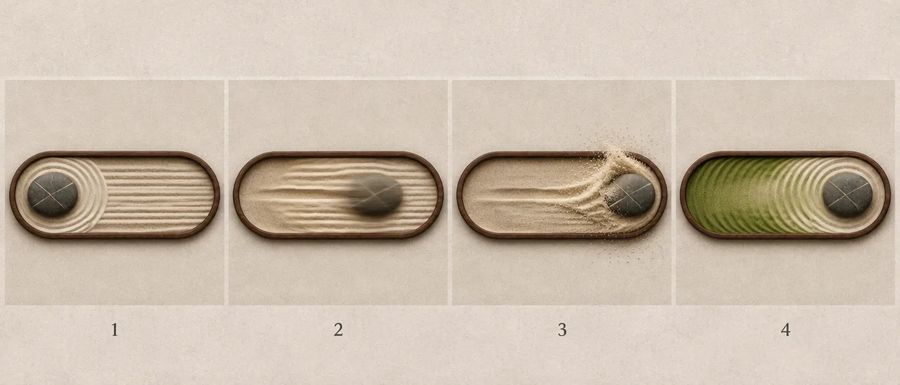
      <br><strong>04 · Toggle explorations</strong>
    </td>
  </tr>
  <tr>
    <td align="center" width="50%">
      
      <br><strong>05 · Composition study</strong>
    </td>
    <td align="center" width="50%">
      
      <br><strong>06 · Stone and material study</strong>
    </td>
  </tr>
</table>

</div>

### Phase 1 component concepts

Each new control also has its own physical-interaction concept sheet. These are design diagrams, not screenshots of the running controls.

<div align="center">

<table>
  <tr>
    <td align="center" width="50%">
      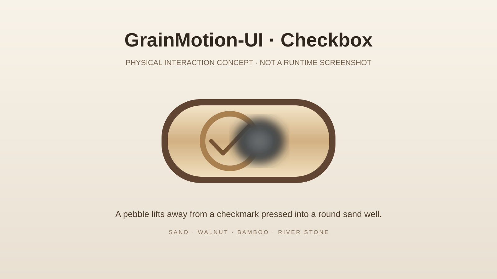
      <br><strong>Checkbox · Revealed mark</strong>
    </td>
    <td align="center" width="50%">
      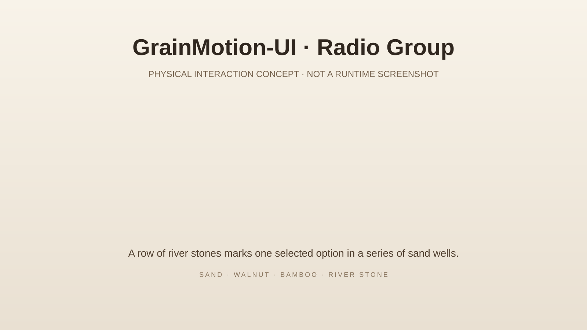
      <br><strong>Radio Group · Selected pebble</strong>
    </td>
  </tr>
  <tr>
    <td align="center" width="50%">
      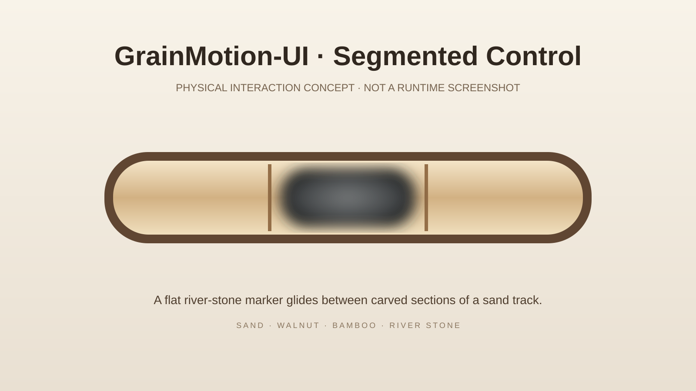
      <br><strong>Segmented · Moving marker</strong>
    </td>
    <td align="center" width="50%">
      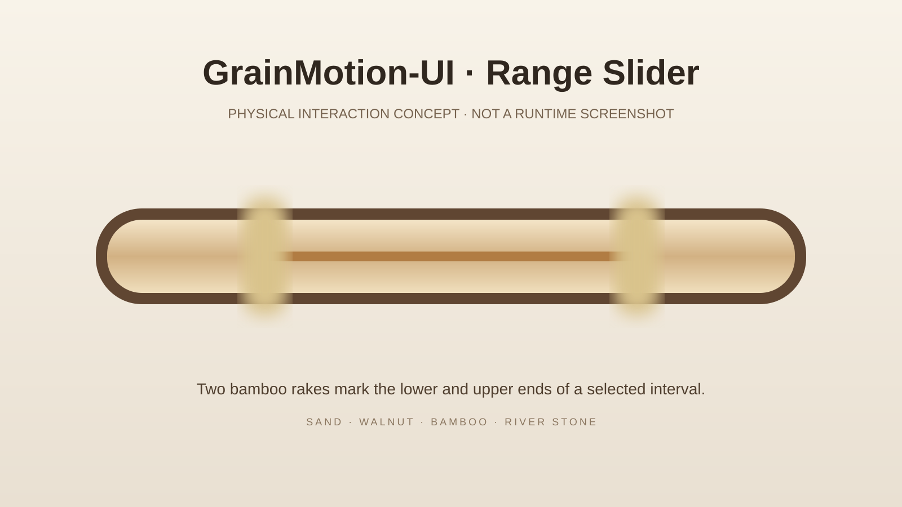
      <br><strong>Range · Two rake handles</strong>
    </td>
  </tr>
  <tr>
    <td align="center" width="50%">
      
      <br><strong>Rating · Five pebble wells</strong>
    </td>
    <td align="center" width="50%">
      <strong>One material language</strong>
      <br>Sand, walnut, bamboo and river stone carry through all forty-five controls.
    </td>
  </tr>
</table>

</div>

### Phase 4 progress and activity concepts

These diagrams illustrate the new progress and loading interactions. They are original concept artwork, not runtime screenshots.

<div align="center">

<table>
<tr><td align="center">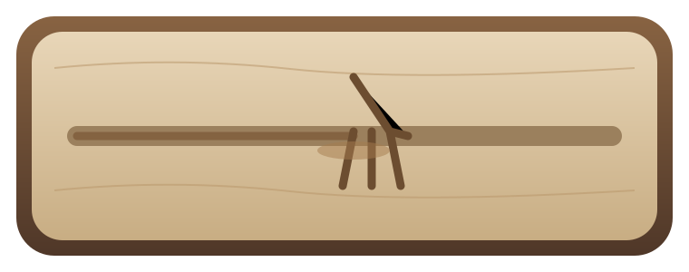<br><strong>Progress Bar</strong></td><td align="center"><br><strong>Progress Ring</strong></td></tr>
<tr><td align="center">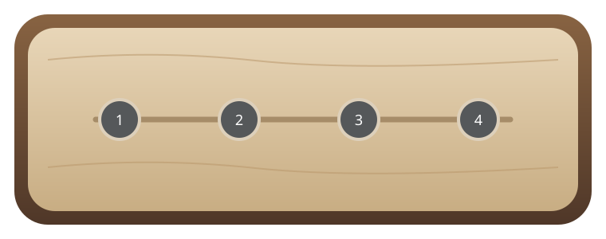<br><strong>Step Indicator</strong></td><td align="center"><br><strong>Hourglass Timer</strong></td></tr>
<tr><td align="center"><br><strong>Loading Indicator</strong></td><td align="center">Five new controls, one consistent sand material language.</td></tr>
</table>

</div>

### Phase 3 selection, calendar and time concepts

The five new controls extend the same physical language into option selection, autocomplete, calendar dates, ranges and time-of-day. The browser-native controls remain responsible for their accessible selection and popup behavior.

<div align="center">

<table>
  <tr>
    <td align="center" width="50%">
      
      <br><strong>Select · Chosen option well</strong>
    </td>
    <td align="center" width="50%">
      
      <br><strong>Combobox · Suggestion rake</strong>
    </td>
  </tr>
  <tr>
    <td align="center" width="50%">
      
      <br><strong>Date Picker · Calendar pebble</strong>
    </td>
    <td align="center" width="50%">
      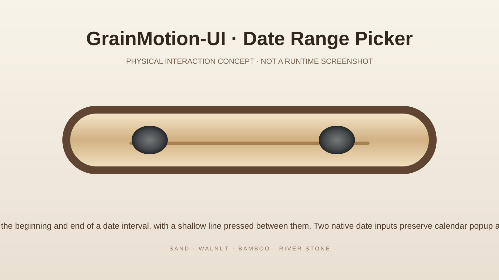
      <br><strong>Date Range · Two markers</strong>
    </td>
  </tr>
  <tr>
    <td align="center" width="50%">
      
      <br><strong>Time Picker · Clock dial</strong>
    </td>
    <td align="center" width="50%">
      <strong>Native controls, tactile surface</strong>
      <br>The browser manages selection, calendar popups, keyboard behavior and form semantics.
    </td>
  </tr>
</table>

</div>

### Phase 2 text-input concepts

The next five studies show how native browser fields sit above the sand renderer. The visual surface is not used to store or draw entered text, especially for passwords and one-time codes.

<div align="center">

<table>
  <tr>
    <td align="center" width="50%">
      
      <br><strong>Text Field · Stylus cue</strong>
    </td>
    <td align="center" width="50%">
      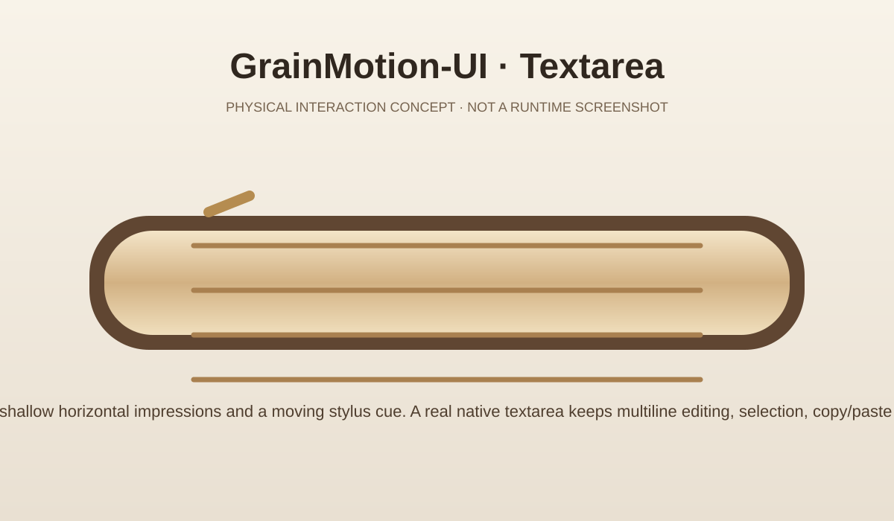
      <br><strong>Textarea · Writing grooves</strong>
    </td>
  </tr>
  <tr>
    <td align="center" width="50%">
      
      <br><strong>Password · Stone shutter</strong>
    </td>
    <td align="center" width="50%">
      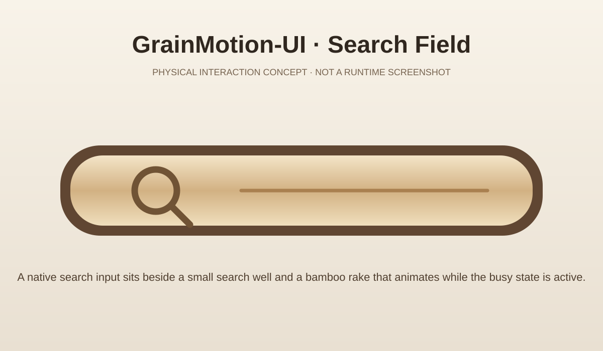
      <br><strong>Search · Moving rake</strong>
    </td>
  </tr>
  <tr>
    <td align="center" width="50%">
      
      <br><strong>OTP / PIN · Digit wells</strong>
    </td>
    <td align="center" width="50%">
      <strong>Native input first</strong>
      <br>Keyboard, paste, selection and autofill stay with the browser's real input.
    </td>
  </tr>
</table>

</div>

See [making-of/](making-of/) for the design notes, concept images, and prompts behind the visual direction.


### Phase 6 media, file and visual concepts

The six studies below show the material direction for file arrival, transfer state, image framing, expanded viewing, media position and mineral pigment. These are design concepts, not screenshots of the running components.

<div align="center">

<table>
<tr><td align="center">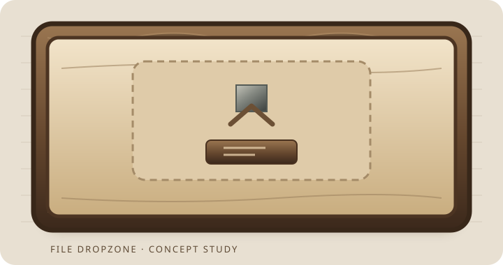<br><strong>File Dropzone</strong></td><td align="center"><br><strong>Upload Queue</strong></td></tr>
<tr><td align="center"><br><strong>Image Carousel</strong></td><td align="center">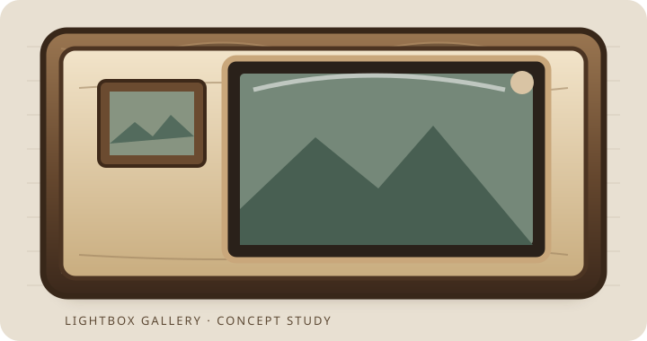<br><strong>Lightbox Gallery</strong></td></tr>
<tr><td align="center">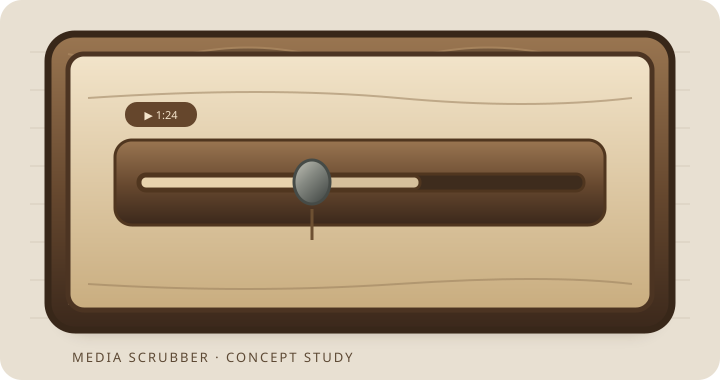<br><strong>Media Scrubber</strong></td><td align="center">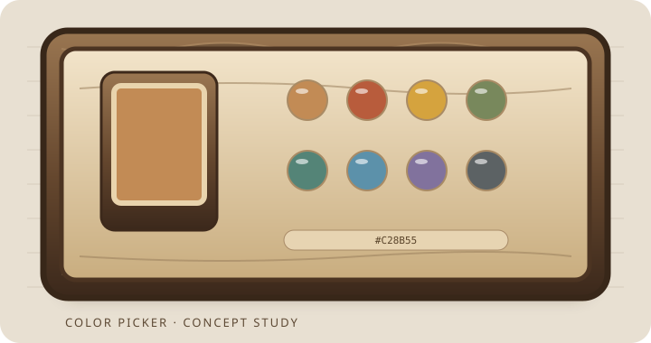<br><strong>Color Picker</strong></td></tr>
</table>

</div>

### Phase 7 list and layout concepts

These five studies illustrate ordering, transfer, split layout, multi-panel resizing and nested navigation. They document the physical language behind the controls and are concept artwork rather than runtime screenshots.

<div align="center">

<table>
<tr><td align="center">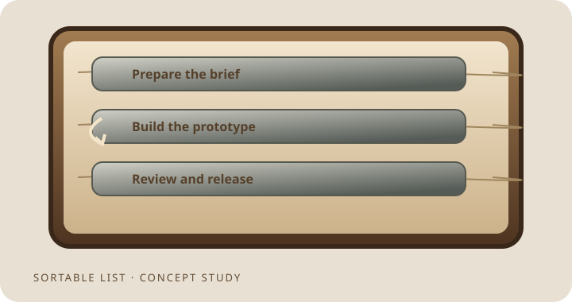<br><strong>Sortable List</strong></td><td align="center">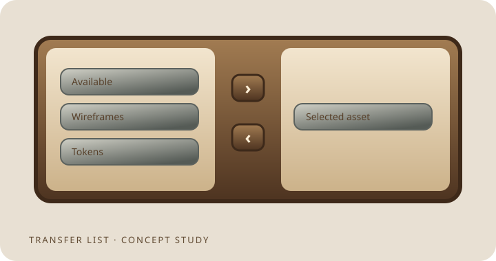<br><strong>Transfer List</strong></td></tr>
<tr><td align="center">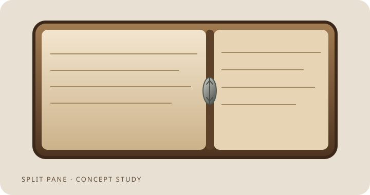<br><strong>Split Pane</strong></td><td align="center">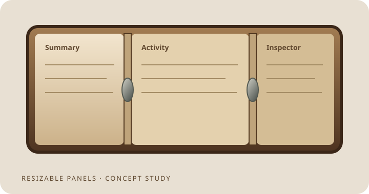<br><strong>Resizable Panels</strong></td></tr>
<tr><td align="center">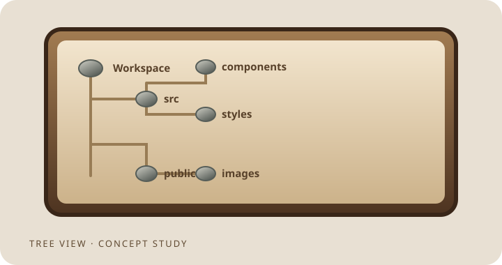<br><strong>Tree View</strong></td><td align="center"><strong>One interaction language</strong><br>Every divider, list row and branch has an explicit data API and keyboard alternative.</td></tr>
</table>

</div>

### Phase 8 feedback and overlay concepts

These studies distinguish transient notifications, persistent alerts, non-interactive hints, native modal surfaces and edge sheets. They are concept diagrams, not screenshots of the running components.

<div align="center">

<table>
<tr><td align="center">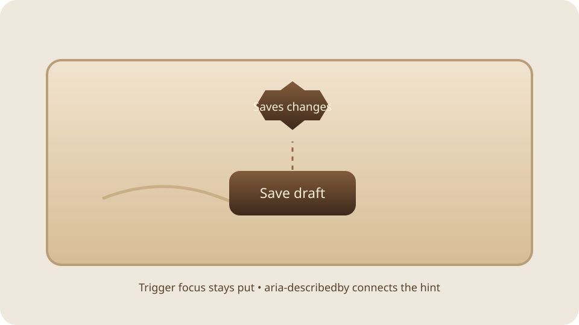<br><strong>Tooltip</strong></td><td align="center">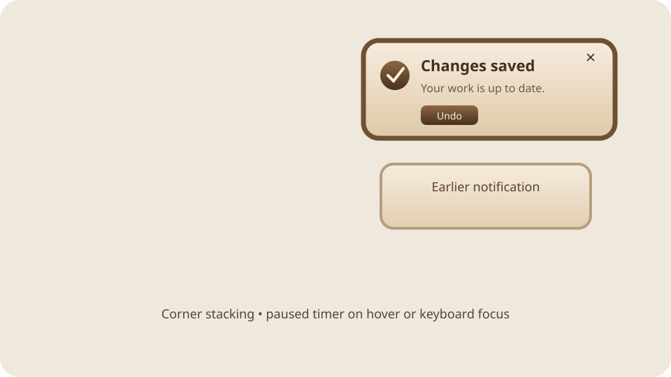<br><strong>Toast Notification</strong></td></tr>
<tr><td align="center">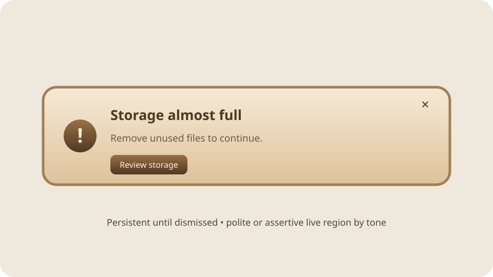<br><strong>Alert Banner</strong></td><td align="center">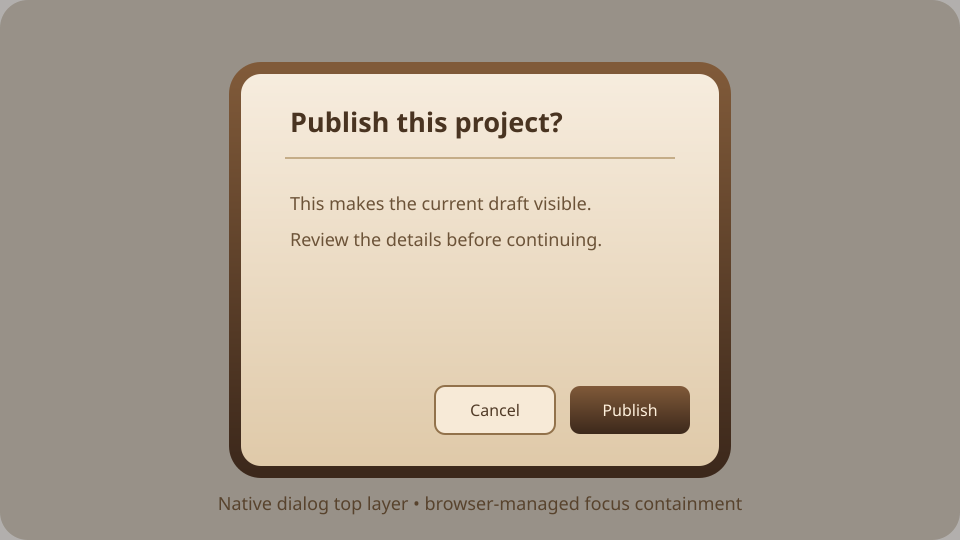<br><strong>Dialog / Modal</strong></td></tr>
<tr><td align="center">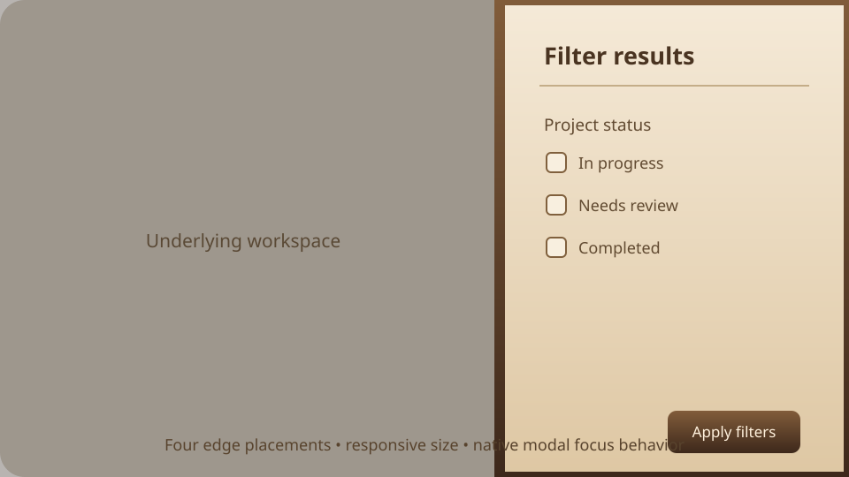<br><strong>Drawer / Sheet</strong></td><td align="center"><strong>Accessibility first</strong><br>Native dialog top-layer behavior, live regions, Escape dismissal and focus restoration guide the implementation.</td></tr>
</table>

</div>

## ⚙️ How it works

The sand is simulated, not a static texture. A height field stores the sand surface, JavaScript updates it as controls move, and a WebGL2 shader lights the surface to reveal grooves, ridges, shadows, and highlights.

- **Simulation:** the sand height field changes as the user interacts with a control.
- **Relaxation:** displaced sand settles toward its angle of rest.
- **Rendering:** WebGL2 shades the surface and gives the sand its depth.
- **Sound:** embedded audio recordings respond to interaction.
- **Custom elements:** each component registers a reusable HTML element.

The shared engine is available through `window.GrainMotionUI`. Each control file contains the engine and its own required assets, so it can be loaded independently.

## 🚀 Installation

### Add a component with the shadcn CLI

Run the command for the component you want:

```bash
npx shadcn add Brajesh31/GrainMotion-UI/slider
npx shadcn add Brajesh31/GrainMotion-UI/toggle
npx shadcn add Brajesh31/GrainMotion-UI/signature
npx shadcn add Brajesh31/GrainMotion-UI/thinking
npx shadcn add Brajesh31/GrainMotion-UI/checkbox
npx shadcn add Brajesh31/GrainMotion-UI/radio-group
npx shadcn add Brajesh31/GrainMotion-UI/segmented
npx shadcn add Brajesh31/GrainMotion-UI/range
npx shadcn add Brajesh31/GrainMotion-UI/rating
npx shadcn add Brajesh31/GrainMotion-UI/input
npx shadcn add Brajesh31/GrainMotion-UI/textarea
npx shadcn add Brajesh31/GrainMotion-UI/password
npx shadcn add Brajesh31/GrainMotion-UI/search
npx shadcn add Brajesh31/GrainMotion-UI/otp
npx shadcn add Brajesh31/GrainMotion-UI/select
npx shadcn add Brajesh31/GrainMotion-UI/combobox
npx shadcn add Brajesh31/GrainMotion-UI/date-picker
npx shadcn add Brajesh31/GrainMotion-UI/date-range
npx shadcn add Brajesh31/GrainMotion-UI/time-picker
```

The files are intended to be placed in `public/grainmotion-ui/`.

### Use a component directly

You can also copy the relevant JavaScript file into your project and load it with a regular script tag.

```html
<script src="/grainmotion-ui/slider.js"></script>
<sand-slider value="40" label="Volume"></sand-slider>
```

Other elements:

```html
<script src="/grainmotion-ui/toggle.js"></script>
<sand-toggle label="Focus mode"></sand-toggle>

<script src="/grainmotion-ui/signature.js"></script>
<sand-signature name="signature"></sand-signature>

<script src="/grainmotion-ui/thinking.js"></script>
<sand-thinking state="thinking"></sand-thinking>

<script src="/grainmotion-ui/checkbox.js"></script>
<sand-checkbox label="Enable notifications" value="yes"></sand-checkbox>

<script src="/grainmotion-ui/radio-group.js"></script>
<sand-radio-group label="Size" options="Small,Medium,Large" value="Medium"></sand-radio-group>

<script src="/grainmotion-ui/segmented.js"></script>
<sand-segmented label="Period" options="Day,Week,Month" value="Week"></sand-segmented>

<script src="/grainmotion-ui/range.js"></script>
<sand-range label="Budget" low="20" high="80"></sand-range>

<script src="/grainmotion-ui/rating.js"></script>
<sand-rating label="Rating" value="4"></sand-rating>

<script src="/grainmotion-ui/input.js"></script>
<sand-input label="Display name" placeholder="Your name"></sand-input>

<script src="/grainmotion-ui/textarea.js"></script>
<sand-textarea label="Message" rows="4"></sand-textarea>

<script src="/grainmotion-ui/password.js"></script>
<sand-password label="Password" autocomplete="current-password"></sand-password>

<script src="/grainmotion-ui/search.js"></script>
<sand-search label="Search" placeholder="Search"></sand-search>

<script src="/grainmotion-ui/otp.js"></script>
<sand-otp label="Verification code" length="6" autocomplete="one-time-code"></sand-otp>

<script src="/grainmotion-ui/select.js"></script>
<sand-select label="Delivery speed" options="standard:Standard,express:Express" placeholder="Choose delivery"></sand-select>

<script src="/grainmotion-ui/combobox.js"></script>
<sand-combobox label="City" options="DEL:Delhi,BLR:Bengaluru"></sand-combobox>

<script src="/grainmotion-ui/date-picker.js"></script>
<sand-date-picker label="Start date" min="2026-01-01" max="2026-12-31"></sand-date-picker>

<script src="/grainmotion-ui/date-range.js"></script>
<sand-date-range label="Stay dates" name="stay"></sand-date-range>

<script src="/grainmotion-ui/time-picker.js"></script>
<sand-time-picker label="Appointment" format="12" step="900"></sand-time-picker>
```

For the thinking component, update its state as your agent works:

```js
const indicator = document.querySelector("sand-thinking");

indicator.state = "searching";
// Supported states: thinking, searching, tool, writing, idle
```

Check each component's documentation for its attributes, properties, events, and form behavior.

## 🔊 Sound controls

Sound starts after the first user touch or key interaction. You can mute the shared sound engine:

```js
window.GrainMotionUI.Sound.on = false;
```

## 🧑‍💻 Run locally

Clone the repository and start a local static server:

```bash
git clone https://github.com/Brajesh31/GrainMotion-UI.git
cd GrainMotion-UI
python3 -m http.server 8000
```

Open [http://localhost:8000](http://localhost:8000) to explore the gallery.

## 🛠️ Development

The repository includes scripts for building the standalone controls, generating documentation, capturing screenshots, and testing interactions.

| File | Purpose |
|---|---|
| `core.js` | Shared sand simulation and rendering engine |
| `tools/build.mjs` | Stamps the shared engine and embedded assets into each control |
| `tools/docs.mjs` | Generates component documentation, demo pages, registry metadata, and `llms.txt` from the component specification |
| `tools/spec.mjs` | Central component specification |
| `tools/test.mjs` | Exercises controls with touch and keyboard interactions |
| `tools/shot.mjs` | Captures browser screenshots |
| `skills/grainmotion-ui/` | Agent skill, engine reference, starter example, and visual inspection helper |

Useful commands:

```bash
node tools/build.mjs
node tools/build.mjs --check
node tools/docs.mjs
node tools/docs.mjs --check
node tools/test.mjs http://localhost:8000/gallery/
```

The browser test and screenshot utilities require Chrome or Chromium. See the individual scripts for their arguments and environment options.

## 📚 Documentation

- [Complete project documentation index](docs/README.md)
- [50-component expansion roadmap](docs/ROADMAP.md)
- [Component catalog and implementation status](docs/COMPONENT-CATALOG.md)
- [Phase 7 advanced layout implementation spec](docs/PHASE-7-ADVANCED-LAYOUT-SPEC.md)
- [Phase 8 feedback and overlay implementation spec](docs/PHASE-8-FEEDBACK-OVERLAYS-SPEC.md)
- [Architecture and shared sand engine](docs/ARCHITECTURE.md)
- [Design system and visual standards](docs/DESIGN-SYSTEM.md)
- [Asset catalog and creation standards](docs/ASSET-CATALOG.md)
- [Accessibility standards](docs/ACCESSIBILITY.md)
- [Performance and rendering plan](docs/PERFORMANCE.md)
- [Testing strategy](docs/TESTING.md)
- [Browser support matrix](docs/BROWSER-SUPPORT.md)
- [Contribution guide](docs/CONTRIBUTING.md)
- [Component creation guide](docs/COMPONENT-CREATION-GUIDE.md)
- [Live component gallery](https://brajesh31.github.io/GrainMotion-UI/)
- [Slider documentation](slider/README.md)
- [Toggle documentation](toggle/README.md)
- [Signature documentation](signature/README.md)
- [Thinking documentation](thinking/README.md)
- [Checkbox documentation](checkbox/README.md)
- [Radio Group documentation](radio-group/README.md)
- [Segmented Control documentation](segmented/README.md)
- [Range Slider documentation](range/README.md)
- [Rating documentation](rating/README.md)
- [Text Field documentation](input/README.md)
- [Textarea documentation](textarea/README.md)
- [Password Field documentation](password/README.md)
- [Search Field documentation](search/README.md)
- [OTP / PIN documentation](otp/README.md)
- [Select / Dropdown documentation](select/README.md)
- [Combobox / Autocomplete documentation](combobox/README.md)
- [Date Picker documentation](date-picker/README.md)
- [Date Range Picker documentation](date-range/README.md)
- [Time Picker documentation](time-picker/README.md)
- [Loading Indicator documentation](loader/README.md)
- [File Dropzone documentation](dropzone/README.md)
- [Upload Queue documentation](upload-queue/README.md)
- [Image Carousel documentation](carousel/README.md)
- [Lightbox Gallery documentation](lightbox/README.md)
- [Media Scrubber documentation](scrubber/README.md)
- [Color Picker documentation](color-picker/README.md)
- [Sortable List documentation](sortable/README.md)
- [Transfer List documentation](transfer-list/README.md)
- [Split Pane documentation](split-pane/README.md)
- [Resizable Panels documentation](resizable/README.md)
- [Tree View documentation](tree/README.md)
- [Hourglass Timer documentation](timer/README.md)
- [Step Indicator documentation](steps/README.md)
- [Progress Ring documentation](progress-ring/README.md)
- [Progress Bar documentation](progress/README.md)
- [Agent skill](skills/grainmotion-ui/SKILL.md)
- [AI-readable project guide](llms.txt)
- [Design process and concept artwork](making-of/README.md)
## ⚠️ Known limitations

- **WebGL2 required for rendering.** Without WebGL2, the controls may remain keyboard-operable, but the sand visuals will not render.
- **Light backgrounds recommended.** The sand and walnut frame are designed for a light page.
- **Multiple live canvases have a browser limit.** Each component creates its own WebGL canvas, so avoid mounting large numbers simultaneously.
- **Reduced motion is not fully implemented.** The sand continues moving when `prefers-reduced-motion` is enabled.
- **Browser and assistive technology coverage is limited.** The current project notes testing in headless Chromium; broader browser, real-device, and screen-reader testing is still needed.

## 📄 License

This project is distributed under the MIT License. See [LICENSE](LICENSE) for the license text and required copyright notice.

---

<div align="center">

**GrainMotion-UI**

*Let the interface leave a mark.*

[Live Demo](https://brajesh31.github.io/GrainMotion-UI/) · [GitHub Repository](https://github.com/Brajesh31/GrainMotion-UI)

</div>

## 📄 License

GrainMotion-UI is licensed under the [MIT License](LICENSE).

Copyright (c) 2026 Brajesh Kumar.
