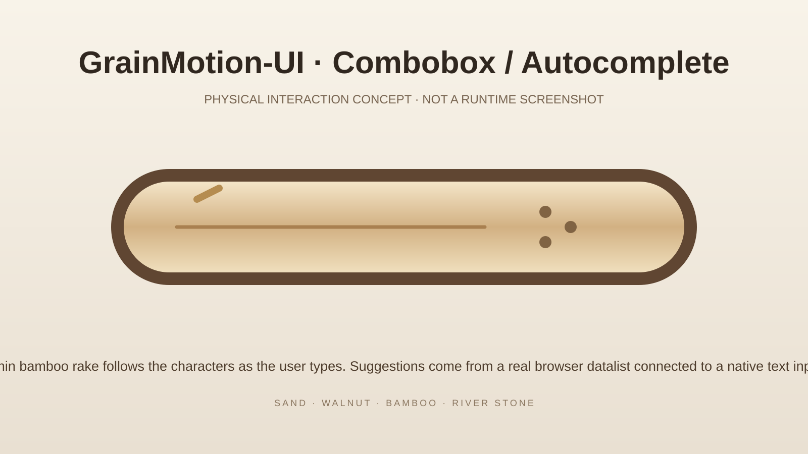

# GrainMotion-UI Combobox / Autocomplete

A thin bamboo rake follows the characters as the user types. Suggestions come from a real browser datalist connected to a native text input.



*Concept diagram, not a runtime screenshot.*

## Live demo

Start a static server from the repository root:

```bash
python3 -m http.server 8000
```

Open [http://localhost:8000/combobox/](http://localhost:8000/combobox/).

## Installation

Each control is a standalone JavaScript file with the sand engine and its configured sounds embedded.

```html
<script src="combobox.js"></script>
<sand-combobox
  name="city"
  label="City"
  options="DEL:Delhi,BLR:Bengaluru,HYD:Hyderabad"
  placeholder="Start typing"></sand-combobox>
```

Load the file with a normal script tag, not as an ES module.

## JavaScript usage

```js
const city = document.querySelector('sand-combobox');
city.addEventListener('option-selected', event => useCity(event.detail.value));
city.addEventListener('input', () => preview(city.value));
```

## Attributes

| Attribute | Behavior | Default |
|---|---|---|
| `options` | Comma-separated suggestions; use value:Label to separate value and label | empty |
| `value` | Initial text value | empty |
| `label` | Accessible name for the native input | Search options |
| `placeholder` | Native input placeholder | empty |
| `name` | Form submission name | empty |
| `disabled` | Disable editing and form participation | absent |
| `required` | Require a non-empty value | absent |
| `autocomplete` | Browser autocomplete hint | off |

## Properties

- `value: string`
- `name: string`
- `disabled: boolean`
- `required: boolean`
- `validity: ValidityState`

## Methods

- `focus(options)`
- `blur()`
- `checkValidity()`
- `reportValidity()`
- `setCustomValidity(message)`

## Events

- Native input and change events bubble from the inner input.
- option-selected, a bubbling custom event for an exact suggestion match, with detail { value, label }.

## Interaction

A bamboo rake follows the typed query as native suggestions appear.

| Action | Result |
|---|---|
| Type a query | The browser offers matching datalist suggestions where supported; the rake follows the input length. |
| Choose a suggestion | The native input receives its value and a matching change emits option-selected. |
| Enter an unlisted value | The value remains valid free text unless your application applies its own validation. |

## Accessibility

- The active selection/date/time control is a real browser-native HTML element, not a canvas imitation.
- The host `label` attribute is applied as the accessible name of the inner control(s).
- Native keyboard, popup, focus, touch and validation behavior is retained.
- Focus on the native control produces a visible sand-frame cue.
- Disabled and required state are forwarded to the native field.
- The sand marker is decorative feedback and never replaces the current value or accessible announcement.

## Form integration

The custom element is form-associated. Set `name` on the custom element itself. A selected value is submitted as a string. Disabled controls submit no value. A required field participates in native validation.

The form value is the selected option or typed text value.

## Localization and timezone behavior

Option labels and native selection UI follow browser language and accessibility conventions.

## Known limitations

- The suggestion popup is native browser UI and is not fully styleable.
- Datalist filtering and announcement details differ across browsers; manual screen-reader verification is required.
- For complex or dynamic datasets, update the options attribute from application code.

- WebGL2 is required for the sand visual layer. Native selection remains functional if the visual layer cannot render.
- Reduced-motion support is not yet complete in the shared sand engine.
- Manual screen-reader and physical-device testing is still required beyond the automated Chromium suite.

## Related documentation

- [Component catalog](../docs/COMPONENT-CATALOG.md)
- [Design system](../docs/DESIGN-SYSTEM.md)
- [Accessibility standards](../docs/ACCESSIBILITY.md)
- [Testing strategy](../docs/TESTING.md)
- [Architecture](../docs/ARCHITECTURE.md)
- [Browser support](../docs/BROWSER-SUPPORT.md)
- [Component creation guide](../docs/COMPONENT-CREATION-GUIDE.md)

## Changelog

- **Phase 3:** Initial implementation, native control integration, validation and documentation.

