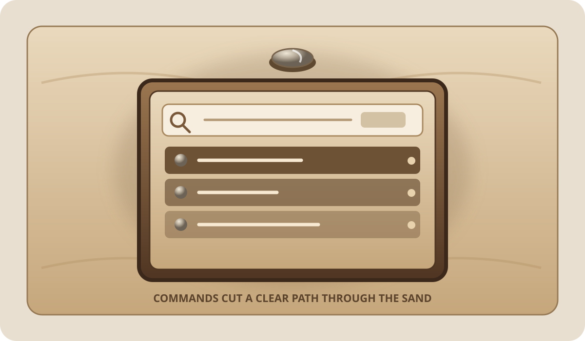

# 🧭 Command Palette

A keyboard-first command launcher built around a searchable list of actions. The palette uses the browser's native modal dialog for the top layer and focus containment. The host application remains responsible for running the selected action.



## ✨ Load it

```html
<script src="/grainmotion-ui/command.js"></script>
<sand-command id="commands"></sand-command>
<script>
  const palette = document.querySelector('sand-command');
  palette.commands = [
    { id: 'new', label: 'New project', description: 'Start a workspace', keywords: 'create add' },
    { id: 'search', label: 'Search files', description: 'Find a file', shortcut: '⌘ P' }
  ];
  palette.addEventListener('command', event => runCommand(event.detail.id));
  document.querySelector('#open').addEventListener('click', () => palette.show());
</script>
```

Add your own trigger button with an accessible name. The label showing Ctrl K in the built-in trigger is a visual hint only. Register a global shortcut in the host and call `show()`.

## ⚙️ API

| API | Type | Description |
|---|---|---|
| `commands` | Property | Array of command records with unique `id`, `label`, optional `description`, `keywords`, `shortcut` and `disabled` |
| `value` | Property | ID of the active result |
| `open` | Attribute / property | Reflects the native modal state |
| `placeholder` | Attribute | Search field placeholder |
| `label` | Attribute | Accessible dialog and trigger name |
| `disabled` | Attribute / property | Prevents opening and command execution |
| `show()` | Method | Opens the palette and focuses its search field |
| `hide(reason)` | Method | Closes the palette with a reason |
| `run(id)` | Method | Emits the selected command and closes the palette |

### Events

| Event | Detail | When |
|---|---|---|
| `command-open` | Empty object | The palette opens |
| `command-close` | `{ reason }` | The palette closes |
| `select` | `{ id, label, command }` | A command is chosen |
| `command` | `{ id, label, command }` | A command is ready for the host to execute |

## ⌨️ Keyboard and accessibility

- Arrow Up / Arrow Down moves the active result.
- Home / End selects the first or last enabled result.
- Enter emits the active command.
- Escape closes the palette.
- The search input has an accessible name. The native `<dialog>` provides the modal top layer and focus containment.

## 🧱 Design and behavior

Typing filters command labels, descriptions and keywords locally. Disabled commands remain visible but cannot be activated. Search is synchronous and in-memory. The component never evaluates a command string or calls a host action directly.

## ⚠️ Limits

Remote command discovery, command permissions, global shortcut registration, execution, recent-command history and persistence belong to the host. The result list is not virtualized, so use host-side or remote search for very large command catalogues. The palette needs WebGL2 for its sand rendering; keyboard and native dialog behavior remain separate from the visual surface.

## 🧪 Demo

Open [the live command palette demo](https://brajesh31.github.io/GrainMotion-UI/command/) or return to the [full gallery](https://brajesh31.github.io/GrainMotion-UI/).
