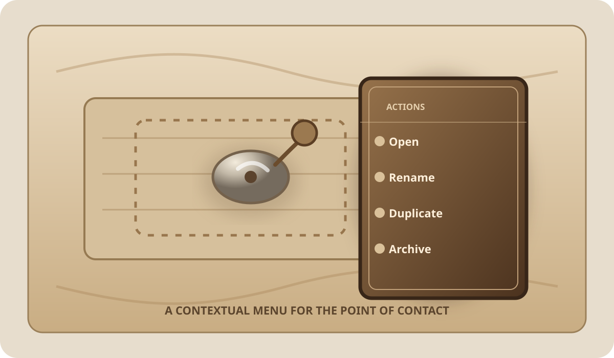

# 🪵 Context Menu

A contextual action tray that opens at the user's point of contact. It supports right-click, touch long-press and the keyboard context-menu shortcut. The component reports the chosen action; the host decides what to do.



## ✨ Load it

```html
<script src="/grainmotion-ui/context-menu.js"></script>
<button id="file-target" type="button">Project file</button>
<sand-context-menu id="file-actions" for="file-target"></sand-context-menu>
<script>
  const menu = document.querySelector('sand-context-menu');
  menu.items = [
    { id: 'rename', label: 'Rename' },
    { id: 'archive', label: 'Archive', shortcut: '⌫' }
  ];
  menu.addEventListener('select', event => performFileAction(event.detail.id));
</script>
```

Without a `for` attribute the component displays its own target surface for demonstration. When using an external target, make sure that target exists before the `for` binding is made.

## ⚙️ API

| API | Type | Description |
|---|---|---|
| `for` | Attribute | ID of the element that receives context, touch and keyboard listeners |
| `items` | Property | Records with unique `id`, `label`, `disabled`, `separator` and `shortcut` |
| `label` | Attribute | Accessible menu name |
| `disabled` | Attribute / property | Prevents opening and selection |
| `showAt(x, y)` | Method | Opens at viewport coordinates |
| `close(reason, restoreFocus)` | Method | Closes and optionally restores target focus |

### Events

| Event | Detail | When |
|---|---|---|
| `menu-open` | `{ x, y }` | Menu opens |
| `select` | `{ id, label }` | An enabled item is selected |
| `menu-select` | `{ id, label }` | Alias event for item selection |
| `menu-close` | `{ reason }` | Menu closes |

## ⌨️ Keyboard and input

- Right-click opens the menu at the pointer.
- A touch long-press opens after approximately 560 ms.
- ContextMenu or Shift + F10 opens near the target.
- Arrow Up / Down and Home / End navigate enabled items.
- Escape closes and returns focus. Tab closes without forcing focus back.

## 🧹 Lifecycle

The component removes target, outside-pointer, resize and scroll listeners when it disconnects or closes. It also cancels a pending long-press timer. Menu labels are inserted as text.

## ⚠️ Limits

Nested submenus, action authorization, item execution and application state remain host responsibilities. Touch long-press is best-effort and can conflict with browser gestures or scroll behavior. Test on real touch hardware. The component needs WebGL2 for its sand rendering.

## 🧪 Demo

Open [the live Context Menu demo](https://brajesh31.github.io/GrainMotion-UI/context-menu/) or return to the [full gallery](https://brajesh31.github.io/GrainMotion-UI/).
