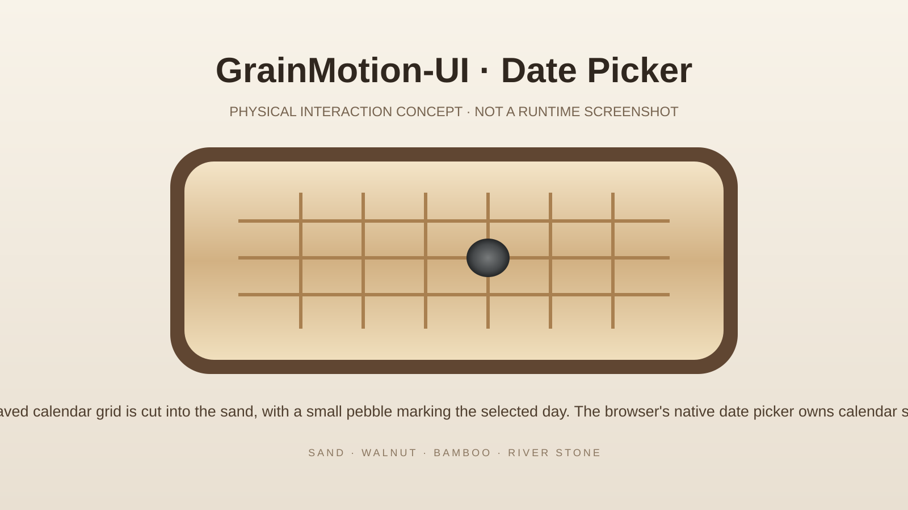

# GrainMotion-UI Date Picker

An engraved calendar grid is cut into the sand, with a small pebble marking the selected day. The browser's native date picker owns calendar selection.



*Concept diagram, not a runtime screenshot.*

## Live demo

Start a static server from the repository root:

```bash
python3 -m http.server 8000
```

Open [http://localhost:8000/date-picker/](http://localhost:8000/date-picker/).

## Installation

Each control is a standalone JavaScript file with the sand engine and its configured sounds embedded.

```html
<script src="date-picker.js"></script>
<sand-date-picker
  name="startDate"
  label="Start date"
  min="2026-01-01"
  max="2026-12-31"
  unavailable="2026-12-25"
  required></sand-date-picker>
```

Load the file with a normal script tag, not as an ES module.

## JavaScript usage

```js
const date = document.querySelector('sand-date-picker');
date.addEventListener('change', () => saveDate(date.value));
date.value = '2026-11-21';
```

## Attributes

| Attribute | Behavior | Default |
|---|---|---|
| `value` | Initial ISO calendar date (YYYY-MM-DD) | empty |
| `label` | Accessible name | Choose a date |
| `name` | Form submission name | empty |
| `min / max` | Inclusive ISO date bounds | unset |
| `unavailable` | Comma-separated ISO dates that fail validation | empty |
| `required` | Require a selected date | absent |
| `disabled` | Disable selection and form participation | absent |
| `lang` | Locale hint for native calendar UI | document language |

## Properties

- `value: string in YYYY-MM-DD form`
- `name: string`
- `disabled: boolean`
- `required: boolean`
- `validity: ValidityState`
- `validationMessage: string`

## Methods

- `focus(options)`
- `blur()`
- `checkValidity()`
- `reportValidity()`
- `setCustomValidity(message)`

## Events

- Native input and change events bubble from the inner date input.

## Interaction

An engraved calendar grid holds a pebble on the selected day.

| Action | Result |
|---|---|
| Open the date field | The browser opens its native date picker. |
| Choose a date | The ISO date value updates and the pebble marks its day position. |
| Choose an unavailable date | The field becomes invalid with an explanatory validation message. |
| Set min or max | The browser enforces the inclusive date bounds. |

## Accessibility

- The active selection/date/time control is a real browser-native HTML element, not a canvas imitation.
- The host `label` attribute is applied as the accessible name of the inner control(s).
- Native keyboard, popup, focus, touch and validation behavior is retained.
- Focus on the native control produces a visible sand-frame cue.
- Disabled and required state are forwarded to the native field.
- The sand marker is decorative feedback and never replaces the current value or accessible announcement.

## Form integration

The custom element is form-associated. Set `name` on the custom element itself. A selected value is submitted as a string. Disabled controls submit no value. A required field participates in native validation.

The submitted value is an ISO calendar date string (`YYYY-MM-DD`), not a timestamp.

## Localization and timezone behavior

The browser-native date input localizes its displayed calendar controls according to browser and operating-system language. The component value remains the ISO `YYYY-MM-DD` calendar date and is not converted through a local timezone.

## Known limitations

- Individual unavailable days are validated after selection; the native calendar popup is not modified to gray them out.
- Calendar appearance and keyboard behavior are controlled by the browser/operating system and vary by platform.
- The value is a calendar date, not a timestamp or timezone-aware instant.

- WebGL2 is required for the sand visual layer. Native selection remains functional if the visual layer cannot render.
- Reduced-motion support is not yet complete in the shared sand engine.
- Manual screen-reader and physical-device testing is still required beyond the automated Chromium suite.

## Related documentation

- [Component catalog](../docs/COMPONENT-CATALOG.md)
- [Design system](../docs/DESIGN-SYSTEM.md)
- [Accessibility standards](../docs/ACCESSIBILITY.md)
- [Testing strategy](../docs/TESTING.md)
- [Architecture](../docs/ARCHITECTURE.md)
- [Browser support](../docs/BROWSER-SUPPORT.md)
- [Component creation guide](../docs/COMPONENT-CREATION-GUIDE.md)

## Changelog

- **Phase 3:** Initial implementation, native control integration, validation and documentation.

