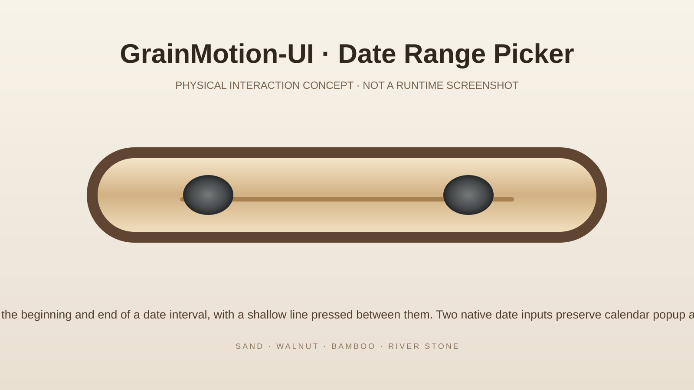

# GrainMotion-UI Date Range Picker

Two river stones mark the beginning and end of a date interval, with a shallow line pressed between them. Two native date inputs preserve calendar popup and keyboard behavior.



*Concept diagram, not a runtime screenshot.*

## Live demo

Start a static server from the repository root:

```bash
python3 -m http.server 8000
```

Open [http://localhost:8000/date-range/](http://localhost:8000/date-range/).

## Installation

Each control is a standalone JavaScript file with the sand engine and its configured sounds embedded.

```html
<script src="date-range.js"></script>
<sand-date-range
  name="stay"
  label="Stay dates"
  start="2026-11-21"
  end="2026-11-25"
  min="2026-01-01"
  max="2026-12-31"
  required></sand-date-range>
```

Load the file with a normal script tag, not as an ES module.

## JavaScript usage

```js
const range = document.querySelector('sand-date-range');
range.addEventListener('date-range-change', ({ detail }) => {
  showDates(detail.start, detail.end);
});
range.start = '2026-11-21';
range.end = '2026-11-25';
```

## Attributes

| Attribute | Behavior | Default |
|---|---|---|
| `start / end` | Initial ISO start and end dates | empty |
| `value` | Combined start/end ISO value | empty |
| `label` | Accessible label prefix for the range | Date range |
| `name` | Form submission name | empty |
| `min / max` | Inclusive bounds for both endpoints | unset |
| `unavailable` | Comma-separated ISO dates invalid for either endpoint | empty |
| `required` | Require both endpoints | absent |
| `disabled` | Disable both date fields and form participation | absent |
| `lang` | Locale hint for native date UI | document language |

## Properties

- `value: string in start/end form`
- `start: string in YYYY-MM-DD form`
- `end: string in YYYY-MM-DD form`
- `name: string`
- `disabled: boolean`
- `required: boolean`
- `validity: ValidityState`

## Methods

- `focus(options), moves to the first incomplete endpoint`
- `blur()`
- `checkValidity()`
- `reportValidity()`
- `setCustomValidity(message)`

## Events

- Native input and change events bubble from each internal date input.
- date-range-change, a bubbling custom event with detail { start, end } when an endpoint is committed.

## Interaction

Two river stones mark the start and end of a date interval.

| Action | Result |
|---|---|
| Choose a start date | The first stone moves to that calendar day. |
| Choose an end date | The second stone moves and the interval becomes visible. |
| Set the end before the start | The range receives a validation error. |
| Leave one endpoint empty | The range stays incomplete and required validation fails. |

## Accessibility

- The active selection/date/time control is a real browser-native HTML element, not a canvas imitation.
- The host `label` attribute is applied as the accessible name of the inner control(s).
- Native keyboard, popup, focus, touch and validation behavior is retained.
- Focus on the native control produces a visible sand-frame cue.
- Disabled and required state are forwarded to the native field.
- The sand marker is decorative feedback and never replaces the current value or accessible announcement.

## Form integration

The custom element is form-associated. Set `name` on the custom element itself. A selected value is submitted as a string. Disabled controls submit no value. A required field participates in native validation.

The form value is null until both endpoints are selected. Once complete it is serialized as `YYYY-MM-DD/YYYY-MM-DD`.

## Localization and timezone behavior

The browser-native date input localizes its displayed calendar controls according to browser and operating-system language. The component value remains the ISO `YYYY-MM-DD` calendar date and is not converted through a local timezone.

## Known limitations

- The native calendar popup cannot visually disable individual unavailable days; those dates are rejected through validity after selection.
- The visual marker position is a compact calendar-day scale, not a full month-layout calendar.
- The form value is null until both endpoints are provided; when complete it is serialized as start/end.

- WebGL2 is required for the sand visual layer. Native selection remains functional if the visual layer cannot render.
- Reduced-motion support is not yet complete in the shared sand engine.
- Manual screen-reader and physical-device testing is still required beyond the automated Chromium suite.

## Related documentation

- [Component catalog](../docs/COMPONENT-CATALOG.md)
- [Design system](../docs/DESIGN-SYSTEM.md)
- [Accessibility standards](../docs/ACCESSIBILITY.md)
- [Testing strategy](../docs/TESTING.md)
- [Architecture](../docs/ARCHITECTURE.md)
- [Browser support](../docs/BROWSER-SUPPORT.md)
- [Component creation guide](../docs/COMPONENT-CREATION-GUIDE.md)

## Changelog

- **Phase 3:** Initial implementation, native control integration, validation and documentation.

