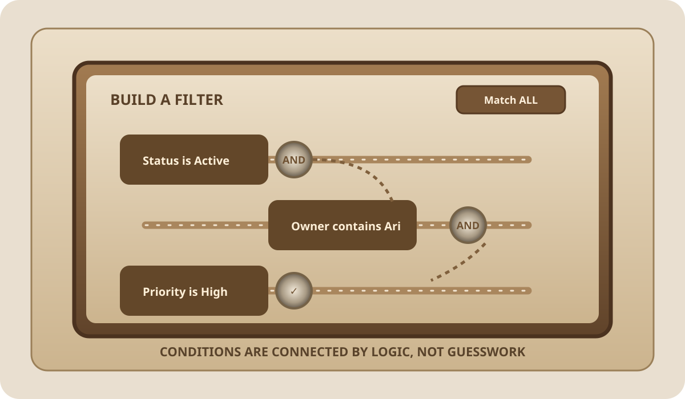

# 🧩 Filter Builder

A structured filter editor for composing simple query conditions. Conditions are represented as connected rows with a shared AND/OR rule. The component exposes a portable query object; it does not execute that query.



## ✨ Load it

```html
<script src="/grainmotion-ui/filter-builder.js"></script>
<sand-filter-builder id="filters"></sand-filter-builder>
<script>
  const filters = document.querySelector('sand-filter-builder');
  filters.fields = [
    { id: 'status', label: 'Status', type: 'select', options: ['Open', 'Done'] },
    { id: 'owner', label: 'Owner', type: 'text' }
  ];
  filters.addEventListener('apply', event => loadResults(event.detail.query));
</script>
```

## ⚙️ API

| API | Type | Description |
|---|---|---|
| `fields` | Property | Array of field definitions with unique `id`, `label`, `type`, and optional `options` |
| `filters` | Property | Array of condition records with `id`, `field`, `operator` and `value` |
| `logic` | Property | Shared condition group, `AND` or `OR` |
| `disabled` | Attribute | Disables editing and apply controls |
| `add(field?)` | Method | Adds a condition |
| `remove(index)` | Method | Removes a condition by index |
| `clear()` / `reset()` | Method | Removes all conditions |
| `toQuery()` | Method | Returns `{ logic, conditions }` without internal row IDs |
| `apply()` | Method | Emits the current query to the host |

### Field types and operators

Field types: `text`, `number`, `date` and `select`.

Operators: `is`, `is-not`, `contains`, `starts-with`, `greater-than`, `less-than`, `before`, `after`, `empty` and `not-empty`.

### Events

| Event | Detail | When |
|---|---|---|
| `input` / `change` | `{ reason, logic, filters, query }` | A condition or logic value changes |
| `apply` | `{ logic, filters, query }` | User or host applies the current conditions |
| `reset` | `{ logic, filters: [] }` | The host clears conditions |

## 🧠 Query contract

Example output:

```json
{
  "logic": "OR",
  "conditions": [
    { "field": "status", "operator": "is", "value": "Open" },
    { "field": "owner", "operator": "contains", "value": "Ari" }
  ]
}
```

This is a data contract, not an SQL fragment. Validate field names, operators, values and user permissions on the server before translating a query into a database operation.

## ⚠️ Limits

Only one shared AND/OR group is supported. Nested groups, custom operators, async field discovery, per-field validation and backend execution are not included. The host owns query validation, security and fetching. The component needs WebGL2 for sand rendering.

## 🧪 Demo

Open [the live Filter Builder demo](https://brajesh31.github.io/GrainMotion-UI/filter-builder/) or return to the [full gallery](https://brajesh31.github.io/GrainMotion-UI/).
