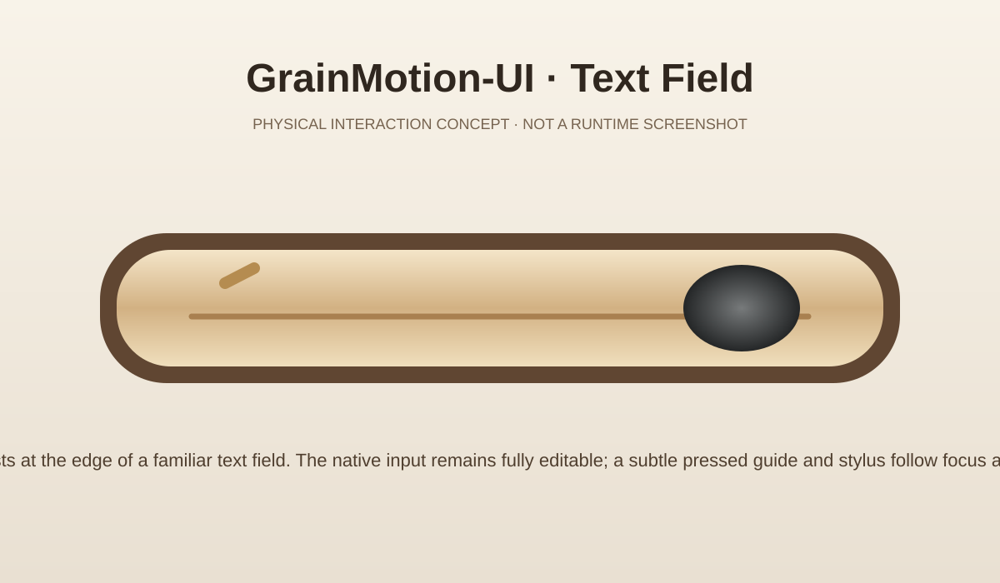

# GrainMotion-UI Text Field

A bamboo stylus rests at the edge of a familiar text field. The native input remains fully editable; a subtle pressed guide and stylus follow focus and caret movement.



*Concept diagram, not a runtime screenshot.*

## Live demo

Start a server with `python3 -m http.server 8000` and open `http://localhost:8000/input/`.

## Installation

```html
<script src="input.js"></script>
<sand-input name="displayName" label="Display name" placeholder="Your name" autocomplete="name"></sand-input>
```

## JavaScript usage

```js
const field = document.querySelector('sand-input');
field.addEventListener('input', () => preview(field.value));
field.addEventListener('change', () => save(field.value));
field.value = 'Updated from code';
```

## Attributes

| Attribute | Behavior | Default |
|---|---|---|
| `value` | Initial text value | empty |
| `label` | Accessible name | Text field |
| `placeholder` | Native placeholder | empty |
| `name` | Form field name | empty |
| `type` | text, email, tel, url or search | text |
| `inputmode` | Virtual keyboard hint | text |
| `autocomplete` | Browser autocomplete hint | off |
| `required` | Required field | absent |
| `disabled` | Disable editing and submission | absent |
| `readonly` | Prevent editing | absent |
| `minlength / maxlength` | Native length constraints | unset |
| `pattern` | Native regular-expression constraint | unset |

## Properties

- `value: string`
- `disabled: boolean`
- `readOnly: boolean`
- `required: boolean`
- `name: string`
- `validity: ValidityState`
- `validationMessage: string`
- `selectionStart` and `selectionEnd`

## Methods

- `focus(options)` and `blur()`
- `setSelectionRange(start, end, direction)`
- `checkValidity()` and `reportValidity()`
- `setCustomValidity(message)`

## Events

- input, bubbles from the internal native input
- change, bubbles from the internal native input

## Accessibility

The visible control contains a real browser-native input. The `label` attribute is applied as its accessible name. Native keyboard editing, selection, copy/paste, required state and browser validation are retained. The sand renderer is visual feedback only.

## Forms

The custom element is form-associated. Put `name` on the custom element itself. The value is serialized as a string, disabled controls submit no value, and form reset restores the initial `value` attribute.

## Limitations

- The stylus position is an approximation of the native caret.
- WebGL2 is required for the sand visual layer, not for the underlying native input.
- Reduced-motion support and manual screen-reader/device verification remain open.

## Related docs

- [Component catalog](../docs/COMPONENT-CATALOG.md)
- [Accessibility](../docs/ACCESSIBILITY.md)
- [Testing](../docs/TESTING.md)
- [Architecture](../docs/ARCHITECTURE.md)
