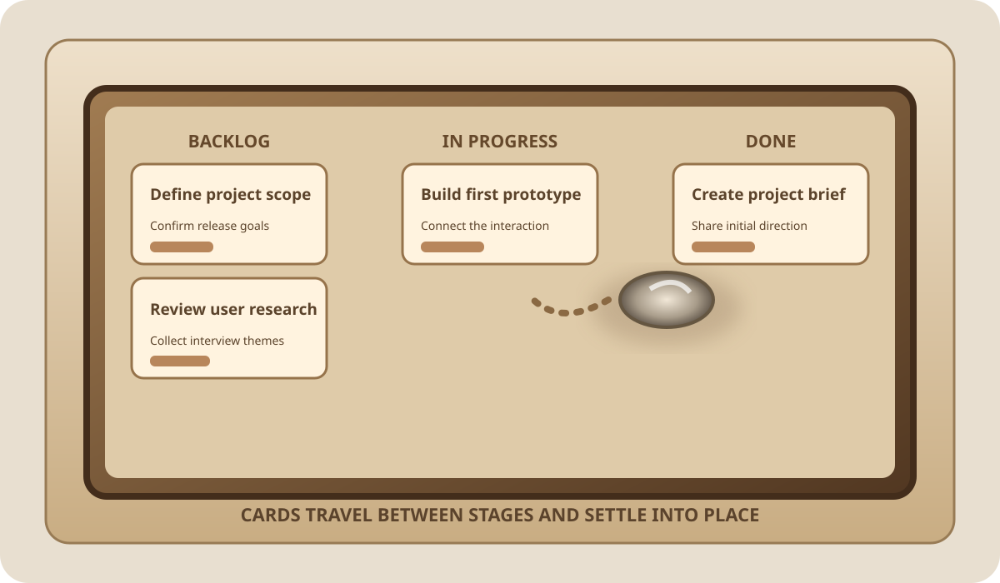

# 🗂️ Kanban Board

A multi-column board for moving task cards between workflow stages. Cards can be moved with native drag-and-drop, directional controls or the keyboard. The board emits the updated state; the host persists it.



## ✨ Load it

```html
<script src="/grainmotion-ui/kanban.js"></script>
<sand-kanban id="board"></sand-kanban>
<script>
  const board = document.querySelector('sand-kanban');
  board.columns = [
    { id: 'todo', label: 'To do', cards: [{ id: 'a', title: 'Write the brief' }] },
    { id: 'doing', label: 'In progress', cards: [] },
    { id: 'done', label: 'Done', cards: [] }
  ];
  board.addEventListener('move', event => persistBoard(event.detail.columns));
</script>
```

## ⚙️ API

| API | Type | Description |
|---|---|---|
| `columns` | Property | Column records with unique `id`, `label` and `cards` |
| `value` | Property | Alias for the columns array |
| `disabled` | Attribute | Disables card controls, drag and drop and keyboard movement |
| `label` | Attribute | Accessible board name |
| `moveCard(id, columnId, index?)` | Method | Moves a card into a target column and optional insertion index |
| `action(id, direction)` | Method | Moves left/right between columns or up/down within one column |

Each card record has a unique `id`, `title`, optional `description`, `priority=low|normal|high` and optional `disabled` state. IDs must be unique across the board.

### Events

| Event | Detail | When |
|---|---|---|
| `move` | `{ id, card, from, to, fromIndex, toIndex, columns }` | A card changes position |
| `change` | Same detail as `move` | Board state changes |
| `select` | `{ id, card, column }` | A card title is activated |

## ⌨️ Accessible movement

- Arrow Left / Right moves a card to the previous / next column.
- Arrow Up / Down changes the card's position in its column.
- Home / End moves the card to the start / end of its current column.
- Each card also has visible arrow buttons. Drag-and-drop is an enhancement, not the only interaction.

## 🧹 State and persistence

The `columns` getter returns a copied column/card structure. A move event includes the resulting columns. Persist that value from the host, and reassign it when the saved board is loaded. The component does not make network requests or write to local storage.

## ⚠️ Limits

The component renders all supplied cards and does not virtualize a very large board. Swimlanes, column creation, editing, workflow permissions, remote persistence and conflict resolution are not included. Native HTML drag-and-drop and touch behavior vary, so test on target devices; use the arrow controls as the keyboard alternative. WebGL2 is required for sand rendering.

## 🧪 Demo

Open [the live Kanban Board demo](https://brajesh31.github.io/GrainMotion-UI/kanban/) or return to the [full gallery](https://brajesh31.github.io/GrainMotion-UI/).
