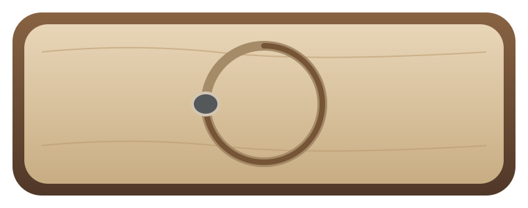

# GrainMotion-UI Progress Ring

A circular progress indicator with a river pebble travelling around an engraved sand groove. Supports determinate and indeterminate states.



*Original concept illustration, not a runtime screenshot.*

## Live demo

Run a local static server from the repository root:

```bash
python3 -m http.server 8000
```

Open [http://localhost:8000/progress-ring/](http://localhost:8000/progress-ring/).

## Installation

Each component is a standalone JavaScript file with the shared sand engine and its required sounds embedded.

```bash
npx shadcn add Brajesh31/GrainMotion-UI/progress-ring
```

Or load it with a normal script tag:

```html
<script src="progress-ring.js"></script>
<sand-progress-ring value="42" label="Progress Ring"></sand-progress-ring>
```

## JavaScript

```js
const control = document.querySelector('sand-progress-ring');
control.value = 72;
control.toggleAttribute('indeterminate', false);
```

## Attributes and properties

| Attribute / property | Purpose | Default |
|---|---|---|
| `value` | Current progress value | 0 |
| `min / max` | Numeric bounds | 0 / 100 |
| `indeterminate` | Unknown progress, no numeric ARIA value | absent |
| `label` | Accessible progress name | Progress |

Set or read `value` as a number. Values are clamped to min/max.

## Interaction design

A circular progress indicator with a river pebble travelling around an engraved sand groove. Supports determinate and indeterminate states.

Determinate mode reflects value through role=progressbar, aria-valuemin, aria-valuemax and aria-valuenow. Indeterminate mode removes aria-valuenow and communicates activity without inventing a percentage.

## Accessibility

- Status semantics and labels are exposed through ARIA.
- Native buttons remain keyboard operable where applicable.
- The visual sand is supplemental; do not rely on sound or motion alone.
- Reduced-motion preference is respected by the visual animation.
- WebGL2 is needed for the sand artwork; semantics remain on the host element.

## Responsive behavior

The control scales with its CSS width. The demo uses a responsive light layout and avoids fixed desktop-only sizing.

## Known limitations

- The sand surface requires WebGL2.
- Manual screen-reader and physical-device testing remains outstanding.
- Progress and loading indicators are status components, not form inputs.
- The timer uses animation-frame timing and is not a precision alarm clock.
- Step Indicator supports up to five visible steps.

## Related documentation

- [Component catalog](../docs/COMPONENT-CATALOG.md)
- [Accessibility standards](../docs/ACCESSIBILITY.md)
- [Testing strategy](../docs/TESTING.md)
- [Architecture](../docs/ARCHITECTURE.md)
- [Browser support](../docs/BROWSER-SUPPORT.md)
- [Component creation guide](../docs/COMPONENT-CREATION-GUIDE.md)

## Changelog

- **Phase 4:** Initial implementation, demo, documentation and Chromium test coverage.
