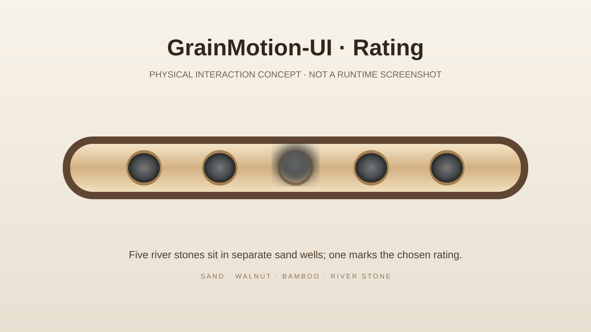

# GrainMotion-UI Rating

Five individually pressed wells hold small pebbles along a horizontal tray. Choosing a rating lifts the selected pebble into a more prominent position while the remaining stones stay settled in their wells.

Five river stones sit in separate sand wells; one marks the chosen rating.

> **Implementation status:** Phase 1 component. This document describes the repository implementation. The component is a standalone custom element bundled with the GrainMotion-UI sand engine.



*Concept diagram, not a runtime screenshot. See the live demo for the implementation.*

## 1. Run the demo

From the repository root:

```bash
python3 -m http.server 8000
```

Open [http://localhost:8000/rating/](http://localhost:8000/rating/).

The demo uses the same light page, walnut frame, sand surface, dark stones and typography as the original four components.

## 2. Installation

The component is distributed as one standalone JavaScript file. It includes the shared engine and the sound assets it uses.

```bash
npx shadcn add Brajesh31/GrainMotion-UI/rating
```

Or copy `rating.js` into your project and load it using a normal script tag:

```html
<script src="rating.js"></script>
<sand-rating name="product-rating" label="Product rating" value="4"></sand-rating>
```

Do not load the file as an ES module. It registers its custom element when evaluated.

## 3. Basic JavaScript usage

```js
const rating = document.querySelector('sand-rating');
rating.addEventListener('change', () => {
  console.log('Rating:', rating.value, 'out of 5');
});
rating.value = 5;
```

## 4. Attributes

| Attribute | Purpose | Default |
|---|---|---|
| `value` | Initial rating from 0 to 5 | 0 |
| `disabled` | Prevents rating changes | absent |
| `label` | Accessible name | Rating |
| `name` | Form field name, omitted from submission when value is 0 |  |

## 5. Properties

- `value: integer from 0 to 5`
- `disabled: boolean`

The element is form-associated. Give it a `name` attribute to include its value in a parent form. See the form behavior below for the exact serialization.

## 6. Events

- input, emitted when the rating changes
- change, emitted after a pointer or keyboard selection

Events bubble so a parent component can listen for them. The `input` event is intended for live updates; `change` indicates a committed selection or completed pointer adjustment.

## 7. Interaction behavior

Click a well to give a rating. Use the arrow keys to adjust it while focused.

| User action | Expected behavior |
|---|---|
| Pointer selection | Updates the value and moves the physical marker through the sand. |
| Keyboard selection | Uses the documented keys and updates accessible state. |
| Value changed through JavaScript | Updates the marker target and form value. |
| Disabled | Prevents user changes and removes the control from normal keyboard interaction. |
| Sound muted | The control remains fully usable without audio. |

## 8. Accessibility

- The custom element exposes a role and accessible name appropriate to the control.
- State or value is reflected through ARIA attributes.
- Keyboard interactions are documented above.
- Focus must remain visible in the host page.
- The visual sand pattern is supplementary. Do not rely on motion or sound alone to communicate the value.

For the Radio Group and Segmented Control, visually hidden native buttons expose the individual radio options to assistive technology. For Range Slider, two visually hidden slider handles expose independent lower and upper values.

## 9. Form integration

The component uses the browser form-associated custom element API. The parent form receives its value when a `name` is present.

```html
<form id="settings">
  <sand-rating name="product-rating" label="Product rating" value="4"></sand-rating>
  <button type="submit">Save</button>
</form>
```

A rating of zero is treated as unanswered and is omitted from the form value.

Form reset restores the initial value. The browser's form-disabled callback is supported.

## 10. Responsive behavior

- The element scales to its CSS width; its height follows its aspect ratio.
- Use a width large enough for the labels and physical interaction to remain legible.
- The demo page is responsive and avoids relying on a fixed desktop-only width.
- Verify the component in the actual host layout, especially when embedded in narrow cards or dialogs.

## 11. Sound design

The control reuses the project's existing recorded stone, tap and settling sounds. Sound is initialized after a user gesture by the shared engine. Set `window.GrainMotionUI.Sound.on = false` to mute the library.

Sound is optional feedback. It is not required to operate the control or understand its current value.

## 12. Performance and lifecycle

- The component uses the shared WebGL2 sand renderer and a 2D overlay for its physical details.
- Each live element currently creates its own WebGL canvas/context.
- Avoid mounting large numbers of live instances simultaneously.
- The host element stops its animation loop when disconnected, following the current shared engine lifecycle.
- The shared engine's broader context and observer cleanup limitations are tracked in [the performance plan](../docs/PERFORMANCE.md).

## 13. Browser requirements

WebGL2 is required for the sand rendering. The current project test baseline is Chromium headless. Safari, Firefox, real devices and screen-reader/browser combinations have not yet been fully verified. See [browser support](../docs/BROWSER-SUPPORT.md).

## 14. Known limitations

- This is an early Phase 1 implementation and needs wider real-device and assistive-technology verification.
- The sand rendering is a visual layer over a functional custom element. When WebGL2 is unavailable, the visual treatment may not render.
- Reduced-motion behavior is not yet fully implemented in the shared engine.
- The rating scale is fixed at zero through five; custom scales are not exposed yet.

## 15. Troubleshooting

| Problem | Check |
|---|---|
| Element is blank | Confirm the script path is correct and the browser supports WebGL2. |
| No sound | Interact with the page first and confirm the shared sound setting is enabled. |
| No form value | Add a `name` attribute and confirm the element is inside a form. |
| The control is too small | Set a larger CSS width and check the available layout space. |
| Keyboard interaction does not work | Focus the component or its accessible option/handle, then use the listed keys. |

## 16. Examples

### Listen for changes

```js
const control = document.querySelector('sand-rating');
control.addEventListener('change', event => {
  console.log('New value:', control.value ?? control.checked);
});
```

### Mute GrainMotion-UI

```js
window.GrainMotionUI.Sound.on = false;
```

## 17. Related documentation

- [Project component catalog](../docs/COMPONENT-CATALOG.md)
- [Design system](../docs/DESIGN-SYSTEM.md)
- [Accessibility standards](../docs/ACCESSIBILITY.md)
- [Performance requirements](../docs/PERFORMANCE.md)
- [Testing strategy](../docs/TESTING.md)
- [Component creation guide](../docs/COMPONENT-CREATION-GUIDE.md)

## 18. Changelog

- **Phase 1:** Initial implementation and documentation.

