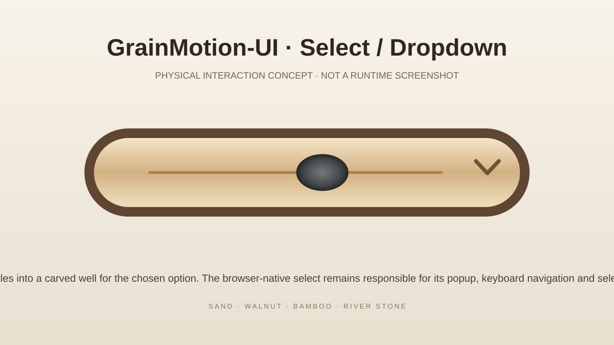

# GrainMotion-UI Select / Dropdown

A river stone settles into a carved well for the chosen option. The browser-native select remains responsible for its popup, keyboard navigation and selection semantics.



*Concept diagram, not a runtime screenshot.*

## Live demo

Start a static server from the repository root:

```bash
python3 -m http.server 8000
```

Open [http://localhost:8000/select/](http://localhost:8000/select/).

## Installation

Each control is a standalone JavaScript file with the sand engine and its configured sounds embedded.

```html
<script src="select.js"></script>
<sand-select
  name="delivery"
  label="Delivery speed"
  options="standard:Standard,express:Express,overnight:Overnight"
  placeholder="Choose delivery"
  required></sand-select>
```

Load the file with a normal script tag, not as an ES module.

## JavaScript usage

```js
const select = document.querySelector('sand-select');
select.addEventListener('change', () => saveDelivery(select.value));
select.value = 'express';
```

## Attributes

| Attribute | Behavior | Default |
|---|---|---|
| `options` | Comma-separated options; use value:Label for distinct values and labels | empty |
| `value` | Initially selected option value | empty |
| `label` | Accessible name for the native select | Select a value |
| `placeholder` | First empty option label | Choose an option |
| `name` | Form submission name | empty |
| `required` | Require a non-empty selection | absent |
| `disabled` | Disable selection and form participation | absent |
| `lang` | Locale hint for browser popup | document language |

## Properties

- `value: string`
- `name: string`
- `disabled: boolean`
- `required: boolean`
- `validity: ValidityState`
- `validationMessage: string`

## Methods

- `focus(options)`
- `blur()`
- `checkValidity()`
- `reportValidity()`
- `setCustomValidity(message)`

## Events

- Native input and change events bubble from the inner select.

## Interaction

A river stone settles in the well of the chosen option.

| Action | Result |
|---|---|
| Open the control | The browser displays its native option picker. |
| Choose an option | The selected value changes and the sand stone settles at the selected position. |
| Update options | The option list is rebuilt, preserving the selected value when it still exists. |

## Accessibility

- The active selection/date/time control is a real browser-native HTML element, not a canvas imitation.
- The host `label` attribute is applied as the accessible name of the inner control(s).
- Native keyboard, popup, focus, touch and validation behavior is retained.
- Focus on the native control produces a visible sand-frame cue.
- Disabled and required state are forwarded to the native field.
- The sand marker is decorative feedback and never replaces the current value or accessible announcement.

## Form integration

The custom element is form-associated. Set `name` on the custom element itself. A selected value is submitted as a string. Disabled controls submit no value. A required field participates in native validation.

The form value is the selected option or typed text value.

## Localization and timezone behavior

Option labels and native selection UI follow browser language and accessibility conventions.

## Known limitations

- The option popup is rendered by the browser/operating system and cannot be styled like a custom HTML menu.
- The physical stone represents the current selection; it does not replace the native select popup.

- WebGL2 is required for the sand visual layer. Native selection remains functional if the visual layer cannot render.
- Reduced-motion support is not yet complete in the shared sand engine.
- Manual screen-reader and physical-device testing is still required beyond the automated Chromium suite.

## Related documentation

- [Component catalog](../docs/COMPONENT-CATALOG.md)
- [Design system](../docs/DESIGN-SYSTEM.md)
- [Accessibility standards](../docs/ACCESSIBILITY.md)
- [Testing strategy](../docs/TESTING.md)
- [Architecture](../docs/ARCHITECTURE.md)
- [Browser support](../docs/BROWSER-SUPPORT.md)
- [Component creation guide](../docs/COMPONENT-CREATION-GUIDE.md)

## Changelog

- **Phase 3:** Initial implementation, native control integration, validation and documentation.

