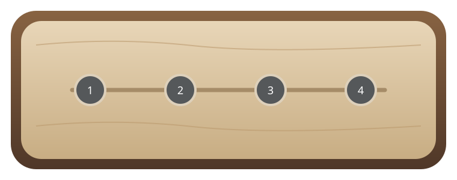

# GrainMotion-UI Step Indicator

A multi-step indicator using stepping stones and native buttons. Completed, current and upcoming steps are visually distinct and keyboard operable.



*Original concept illustration, not a runtime screenshot.*

## Live demo

Run a local static server from the repository root:

```bash
python3 -m http.server 8000
```

Open [http://localhost:8000/steps/](http://localhost:8000/steps/).

## Installation

Each component is a standalone JavaScript file with the shared sand engine and its required sounds embedded.

```bash
npx shadcn add Brajesh31/GrainMotion-UI/steps
```

Or load it with a normal script tag:

```html
<script src="steps.js"></script>
<sand-steps steps="Account,Details,Review,Finish" value="1" label="Setup progress"></sand-steps>
```

## JavaScript

```js
const control = document.querySelector('sand-steps');
control.addEventListener('change', () => showStep(control.value));
control.value = 2;
```

## Attributes and properties

| Attribute / property | Purpose | Default |
|---|---|---|
| `steps` | Comma-separated labels, up to five | Start,Details,Review,Finish |
| `value` | Zero-based active step index | 0 |
| `label` | Accessible group name | Progress steps |
| `name` | Form submission name | empty |
| `disabled` | Disable all step buttons | absent |

Bubbling `input` and `change` events fire when the active index changes.

## Interaction design

A multi-step indicator using stepping stones and native buttons. Completed, current and upcoming steps are visually distinct and keyboard operable.

Each step is a native button with an accessible label. The active step exposes aria-current=step. Completed and upcoming markers are visually distinct.

## Accessibility

- Status semantics and labels are exposed through ARIA.
- Native buttons remain keyboard operable where applicable.
- The visual sand is supplemental; do not rely on sound or motion alone.
- Reduced-motion preference is respected by the visual animation.
- WebGL2 is needed for the sand artwork; semantics remain on the host element.

## Responsive behavior

The control scales with its CSS width. The demo uses a responsive light layout and avoids fixed desktop-only sizing.

## Known limitations

- The sand surface requires WebGL2.
- Manual screen-reader and physical-device testing remains outstanding.
- Progress and loading indicators are status components, not form inputs.
- The timer uses animation-frame timing and is not a precision alarm clock.
- Step Indicator supports up to five visible steps.

## Related documentation

- [Component catalog](../docs/COMPONENT-CATALOG.md)
- [Accessibility standards](../docs/ACCESSIBILITY.md)
- [Testing strategy](../docs/TESTING.md)
- [Architecture](../docs/ARCHITECTURE.md)
- [Browser support](../docs/BROWSER-SUPPORT.md)
- [Component creation guide](../docs/COMPONENT-CREATION-GUIDE.md)

## Changelog

- **Phase 4:** Initial implementation, demo, documentation and Chromium test coverage.
