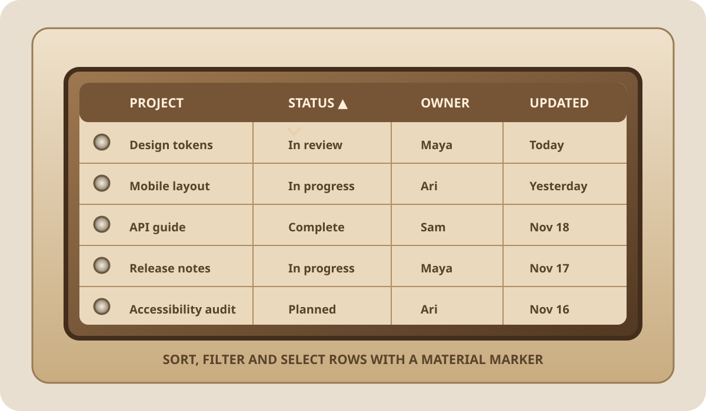

# 📊 Data Table

A searchable, sortable and selectable data table with semantic table markup and client-side pagination. Pagination bounds the rendered number of rows; the host can supply a larger dataset or own server-side pagination.



## ✨ Load it

```html
<script src="/grainmotion-ui/table.js"></script>
<sand-table id="projects" page-size="10"></sand-table>
<script>
  const table = document.querySelector('sand-table');
  table.columns = [
    { key: 'name', label: 'Project' },
    { key: 'status', label: 'Status' }
  ];
  table.rows = [
    { id: 'p1', name: 'Atlas', status: 'In progress' },
    { id: 'p2', name: 'Borealis', status: 'Complete' }
  ];
  table.addEventListener('select', event => saveSelection(event.detail.selected));
</script>
```

## ⚙️ API

| API | Type | Description |
|---|---|---|
| `columns` | Property | Column records with unique `key`, `label`, `sortable`, `hidden` and `align` |
| `rows` | Property | Row records with unique `id` and column values |
| `selected` | Property | Array of selected row IDs |
| `filter` | Property | Case-insensitive substring filter across visible columns |
| `sortBy` | Property | Active sort column key |
| `sortDirection` | Property | `asc` or `desc` |
| `page` | Property | One-based current page |
| `pageSize` | Property / attribute | Rows per page, clamped to 1–100 |
| `disabled` | Attribute | Disables search, selection and pagination |
| `sort(key)` | Method | Sorts by a sortable column; repeated calls toggle direction |
| `select(id, checked)` | Method | Adds/removes one row ID |
| `selectVisible(ids, checked)` | Method | Selects/deselects a visible set of IDs |

### Events

| Event | Detail | When |
|---|---|---|
| `filter` | `{ value }` | Filter text changes |
| `sort` | `{ key, direction }` | Sorting changes |
| `select` | `{ selected, id?, ids?, checked }` | A row or visible page selection changes |
| `change` | Depends on action | Sorting or selection changes |
| `row-activate` | `{ id, row }` | A row receives a double-click |

## 🧮 Sorting and selection

Sorting is stable. Numeric values sort numerically; other values use locale-aware comparison. Search includes visible columns only. Selected IDs remain selected when changing pages or filtering rows. The header checkbox applies to the current page, not all records in the dataset.

## 📐 Rendering strategy

This implementation uses bounded client-side pagination rather than virtual scrolling. With at most 100 rows per page (default five), DOM work stays proportional to the visible page. For large or remote datasets, page records at the host/backend and pass the current page into the component.

## ⚠️ Limits

Column resizing/reordering, row editing, nested rows, CSV export, remote sorting, server filtering, persistence and authorization are outside scope. Cell values are rendered as text. The component needs WebGL2 for sand rendering.

## 🧪 Demo

Open [the live Data Table demo](https://brajesh31.github.io/GrainMotion-UI/table/) or return to the [full gallery](https://brajesh31.github.io/GrainMotion-UI/).
