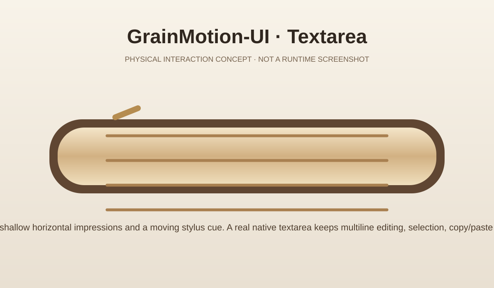

# GrainMotion-UI Textarea

A wider sand-writing panel uses shallow horizontal impressions and a moving stylus cue. A real native textarea keeps multiline editing, selection, copy/paste and browser keyboard behavior.



*Concept diagram, not a runtime screenshot.*

## Live demo

Start a server with `python3 -m http.server 8000` and open `http://localhost:8000/textarea/`.

## Installation

```html
<script src="textarea.js"></script>
<sand-textarea name="message" label="Message" rows="4" maxlength="500" placeholder="Write your message"></sand-textarea>
```

## JavaScript usage

```js
const field = document.querySelector('sand-textarea');
field.addEventListener('input', () => updatePreview(field.value));
field.value = 'A first line\nA second line';
```

## Attributes

| Attribute | Behavior | Default |
|---|---|---|
| `value` | Initial text content | empty |
| `label` | Accessible name | Message |
| `placeholder` | Native placeholder | empty |
| `name` | Form field name | empty |
| `rows` | Visible rows, clamped from 2 to 10 | 4 |
| `cols` | Native column hint | browser default |
| `wrap` | Native wrapping mode | soft |
| `autocomplete` | Browser autocomplete hint | off |
| `required` | Required field | absent |
| `disabled` | Disable editing and submission | absent |
| `readonly` | Prevent editing | absent |
| `minlength / maxlength` | Native length constraints | unset |
| `pattern` | Native text constraint | unset |

## Properties

- `value: string`
- `disabled: boolean`
- `readOnly: boolean`
- `required: boolean`
- `name: string`
- `validity: ValidityState`
- `validationMessage: string`

## Methods

- `focus(options)` and `blur()`
- `checkValidity()` and `reportValidity()`
- `setCustomValidity(message)`

## Events

- input, bubbles from the internal native textarea
- change, bubbles from the internal native textarea

Native `input` and `change` events bubble from the internal browser input. They retain the native event target, so normal listeners and browser editing behavior continue to work.

## Interaction

The inner field is a real browser-native input or textarea. The sand canvas is a visual layer below it; it does not store or draw the entered text.

| Action | Result |
|---|---|
| Type or delete | The native field edits its value and updates the form-associated custom element. |
| Paste | Browser paste behavior is retained. OTP/PIN input sanitizes to digits and configured length. |
| Focus | The sand layer shows a stylus, shutter or active-well cue. |
| Disabled | Native editing is blocked and the custom element stops participating in form submission. |
| Programmatic value | Assigning `element.value` updates the field and form value. It does not synthesize user input events. |

## Accessibility

- A real native `input` or `textarea` provides keyboard, selection, copy/paste and browser validation behavior.
- The `label` attribute is applied as the internal field's accessible name.
- `disabled`, `readonly` and `required` are forwarded to the native field.
- Search exposes pending work using `aria-busy`.
- OTP uses one native input so browser `autocomplete="one-time-code"` remains available.

## Form integration

All five controls are form-associated. Put `name` on the custom element. The current value is serialized as a string; disabled controls submit no value, and form reset restores the initial `value` attribute.

## Known limitations

- The visual tray has a fixed aspect ratio. Native internal scrolling remains available for text that exceeds the visible area.
- The stylus graphic is a focus cue and does not track every wrapped line or pixel of the browser caret.
- WebGL2 is required for the sand visual layer, not for native text entry.
- Reduced-motion support and manual screen-reader/device verification remain open.

## Related docs

- [Component catalog](../docs/COMPONENT-CATALOG.md)
- [Accessibility](../docs/ACCESSIBILITY.md)
- [Testing](../docs/TESTING.md)
- [Architecture](../docs/ARCHITECTURE.md)
- [Browser support](../docs/BROWSER-SUPPORT.md)
- [Component creation guide](../docs/COMPONENT-CREATION-GUIDE.md)

## Changelog

- **Phase 2:** Initial implementation, native field integration, demo and documentation.