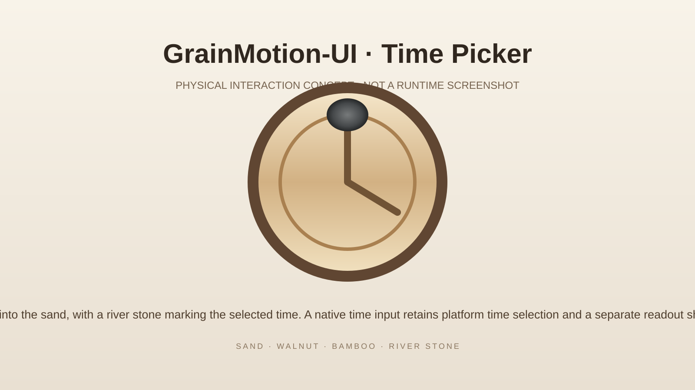

# GrainMotion-UI Time Picker

A small clock dial is etched into the sand, with a river stone marking the selected time. A native time input retains platform time selection and a separate readout shows 12/24-hour formatting.



*Concept diagram, not a runtime screenshot.*

## Live demo

Start a static server from the repository root:

```bash
python3 -m http.server 8000
```

Open [http://localhost:8000/time-picker/](http://localhost:8000/time-picker/).

## Installation

Each control is a standalone JavaScript file with the sand engine and its configured sounds embedded.

```html
<script src="time-picker.js"></script>
<sand-time-picker
  name="appointment"
  label="Appointment time"
  format="12"
  min="09:00"
  max="17:30"
  step="900"
  required></sand-time-picker>
```

Load the file with a normal script tag, not as an ES module.

## JavaScript usage

```js
const time = document.querySelector('sand-time-picker');
time.addEventListener('change', () => saveTime(time.value));
time.format = '24';
time.value = '16:30';
```

## Attributes

| Attribute | Behavior | Default |
|---|---|---|
| `value` | Initial time in 24-hour HH:MM form | empty |
| `label` | Accessible name | Choose a time |
| `name` | Form submission name | empty |
| `format` | Readout format: 12 or 24 | 24 |
| `min / max` | Inclusive time bounds in HH:MM | unset |
| `step` | Native time step in seconds | 60 |
| `required` | Require a time value | absent |
| `disabled` | Disable selection and form participation | absent |
| `lang` | Locale hint for native input presentation | en-US for 12-hour, en-GB for 24-hour |

## Properties

- `value: string in HH:MM form`
- `format: 12 or 24`
- `name: string`
- `disabled: boolean`
- `required: boolean`
- `validity: ValidityState`

## Methods

- `focus(options)`
- `blur()`
- `checkValidity()`
- `reportValidity()`
- `setCustomValidity(message)`

## Events

- Native input and change events bubble from the inner time input.

## Interaction

A small clock dial is etched into the sand, with a stone hand marking the time.

| Action | Result |
|---|---|
| Choose a time | The stone moves around the dial to the corresponding minute of the day. |
| Set format to 12 | The readout displays AM/PM time. |
| Set format to 24 | The readout displays 00:00 through 23:59. |
| Change timezone or DST settings | The raw HH:MM value does not shift because no date or timezone is attached. |

## Accessibility

- The active selection/date/time control is a real browser-native HTML element, not a canvas imitation.
- The host `label` attribute is applied as the accessible name of the inner control(s).
- Native keyboard, popup, focus, touch and validation behavior is retained.
- Focus on the native control produces a visible sand-frame cue.
- Disabled and required state are forwarded to the native field.
- The sand marker is decorative feedback and never replaces the current value or accessible announcement.

## Form integration

The custom element is form-associated. Set `name` on the custom element itself. A selected value is submitted as a string. Disabled controls submit no value. A required field participates in native validation.

The submitted value is a timezone-free `HH:MM` string.

## Localization and timezone behavior

The native time input's control presentation follows the browser/operating-system locale. `format="12"` or `format="24"` sets the explicit readout and a locale hint. Its value remains a timezone-free `HH:MM` string; the component does not turn it into a timestamp.

## Known limitations

- The operating system/browser may render the native time selection popup differently from the explicit 12/24-hour readout.
- A time-only value has no date or timezone and cannot identify a unique point in time across daylight-saving transitions.
- The clock dial is a visual indicator; the native time input remains the actual keyboard-accessible control.

- WebGL2 is required for the sand visual layer. Native selection remains functional if the visual layer cannot render.
- Reduced-motion support is not yet complete in the shared sand engine.
- Manual screen-reader and physical-device testing is still required beyond the automated Chromium suite.

## Related documentation

- [Component catalog](../docs/COMPONENT-CATALOG.md)
- [Design system](../docs/DESIGN-SYSTEM.md)
- [Accessibility standards](../docs/ACCESSIBILITY.md)
- [Testing strategy](../docs/TESTING.md)
- [Architecture](../docs/ARCHITECTURE.md)
- [Browser support](../docs/BROWSER-SUPPORT.md)
- [Component creation guide](../docs/COMPONENT-CREATION-GUIDE.md)

## Changelog

- **Phase 3:** Initial implementation, native control integration, validation and documentation.

