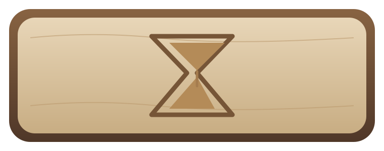

# GrainMotion-UI Hourglass Timer

A countdown timer rendered as a two-chamber hourglass. Sand falls through a narrow waist; pause, resume, reset and cancel controls remain native buttons.



*Original concept illustration, not a runtime screenshot.*

## Live demo

Run a local static server from the repository root:

```bash
python3 -m http.server 8000
```

Open [http://localhost:8000/timer/](http://localhost:8000/timer/).

## Installation

Each component is a standalone JavaScript file with the shared sand engine and its required sounds embedded.

```bash
npx shadcn add Brajesh31/GrainMotion-UI/timer
```

Or load it with a normal script tag:

```html
<script src="timer.js"></script>
<sand-timer duration="90" label="Break timer"></sand-timer>
```

## JavaScript

```js
const control = document.querySelector('sand-timer');
control.start();
control.addEventListener('timer-tick', e => showRemaining(e.detail.remaining));
control.addEventListener('complete', announceDone);
```

## Attributes and properties

| Attribute / property | Purpose | Default |
|---|---|---|
| `duration` | Countdown length in seconds | 60 |
| `label` | Accessible timer name | Countdown timer |
| `disabled` | Disable timer buttons | absent |
| `name` | Form name for remaining seconds | empty |

Properties: `remaining`, `duration`, `running`, `cancelled`.

Methods: `start()`, `pause()`, `reset()`, `cancel()`.

Events: `timer-tick` with `{ remaining }`, and `complete` once when zero is reached.

## Interaction design

A countdown timer rendered as a two-chamber hourglass. Sand falls through a narrow waist; pause, resume, reset and cancel controls remain native buttons.

The countdown advances from requestAnimationFrame delta time. Pause stops elapsed-time reduction; Resume continues; Reset restores the duration; Cancel stops and marks the timer cancelled. Reduced-motion preferences remove the falling stream animation; the hourglass still reflects meaningful countdown state changes.

## Accessibility

- Status semantics and labels are exposed through ARIA.
- Native buttons remain keyboard operable where applicable.
- The visual sand is supplemental; do not rely on sound or motion alone.
- Reduced-motion preference is respected by the visual animation.
- WebGL2 is needed for the sand artwork; semantics remain on the host element.

## Responsive behavior

The control scales with its CSS width. The demo uses a responsive light layout and avoids fixed desktop-only sizing.

## Known limitations

- The sand surface requires WebGL2.
- Manual screen-reader and physical-device testing remains outstanding.
- Progress and loading indicators are status components, not form inputs.
- The timer uses animation-frame timing; background-tab throttling can slow its countdown, so it is not a precision alarm clock.
- Step Indicator supports up to five visible steps.

## Related documentation

- [Component catalog](../docs/COMPONENT-CATALOG.md)
- [Accessibility standards](../docs/ACCESSIBILITY.md)
- [Testing strategy](../docs/TESTING.md)
- [Architecture](../docs/ARCHITECTURE.md)
- [Browser support](../docs/BROWSER-SUPPORT.md)
- [Component creation guide](../docs/COMPONENT-CREATION-GUIDE.md)

## Changelog

- **Phase 4:** Initial implementation, demo, documentation and Chromium test coverage.
